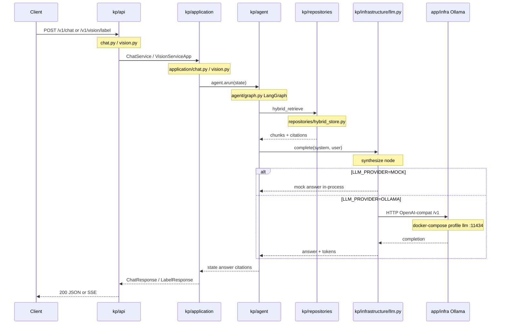
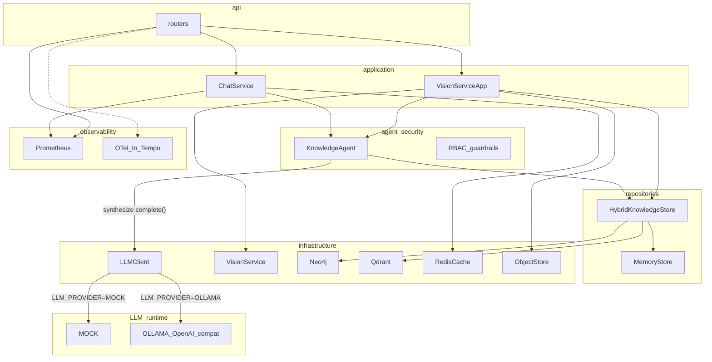

# Backend — Knowledge Platform API

HTTP Control Plane RetailPartnerX: GraphRAG-чат с ACL, распознавание этикеток, семантический кэш и observability. Ответы модели идут через встроенный **`LLMClient`** — бэк не «висит на LLM как сервисе», а **вызывает** её из агента (MOCK локально / Ollama в hybrid).

Запуск стенда и порты — в [docs/SETUP.md](../../docs/SETUP.md). Карта всего `app/` — в [app/README.md](../README.md).

## Стек: что зачем

| Технология | Роль в проекте |
|------------|----------------|
| **FastAPI** + Uvicorn | HTTP API (`/v1/chat`, `/v1/vision/label`, jobs, LLM config, `/health`, `/metrics`) |
| **LangGraph** | Оркестрация агента: guard → retrieve → synthesize → output guard |
| **LangChain OpenAI client** | Вызов Ollama по OpenAI-совместимому `/v1` |
| **Pydantic / Settings** | Контракты запросов и env (`LLM_PROVIDER`, `STORE_BACKEND`, URIs stores) |
| **In-memory store** | Дефолтный GraphRAG-индекс для CI/demo (`STORE_BACKEND=memory`) |
| **Neo4j** | Живой граф сущностей/документов при `live` (+ CLI sync) |
| **Qdrant** | Векторный поиск чанков при `live` (+ CLI sync) |
| **Redis** | Shared semantic cache ответов при `live` |
| **MinIO** | Сырьё и recognized JSON этикеток при `live` (иначе локальный FS) |
| **Pillow / pypdfium2** | Нормализация картинок/PDF перед mock OCR |
| **Prometheus** | Метрики API/RAG/vision/cache/ACL → Grafana KP Overview |
| **OpenTelemetry** | Трейсы запросов → Tempo (Compose `:4318`); логи JSON → Loki via Alloy |

Elasticsearch **не используем** — полнотекст/векторы закрывает Qdrant + lexical rerank в store.

## Связь бэка с LLM

Sequence по слоям (пути — относительно `app/backend/`). Участники названы по папкам, где лежит код.

В превью README/GitHub zoom только у страницы (`Ctrl`+`+`/`-`). Чтобы **приближать саму схему** — открой в [Mermaid Live (zoom / pan)](https://mermaid.live/view#pako:eNp1lF1v2jAUhv_KUa46tTRl61WkISFabd1CgwjqFVLlJgewcGzPdphY1f_eY8cMSLerxD7P-fRrvyaVqjHJILH4q0VZ4R1na8OapQTQzDhecc2kg4ngSB9m41_fPtbcG7c6ZZp_NOq_Ri14xRxX8gO0jgk8tv5HitIpgxEwqJXltMHR9rlcNJHicmWYdaatXGswFaK51vs-XgjBGuY9qLjOJe4tQ41dv4PRiFrMYFaUC0h3w7TaMAfKhP8dt9RQKtgLCu_yqByC2qGB4ONRSgwpdGAsgmwhqs5gQkSJZscrJOopUHFN9n5IcjiZY_rf8NqH95Mk3n-umWnlhXXM4adezBMqpePXGx8wZ3L9zS9CuHU3hXAKGWz2L4bXzwYdHcEOz8NF5vSQ0uhgvSlWGLDBschq08qthUuouAut2dPEdKyEqEYLdHhh99ZhcwWtRdNrJoB2L90GLf-DIEnhnmCCtJFPn2fz4unh7n7-dVpMfnoDeJeTOhpVbYFJ-5uCcTnQRlVoQy0oLJ7HKPJ8PB0fo4xGnXYy-L5YzKDQKMcPA182yYW00pHHYg90TTnRBFBRDsq54gKBJAvZcHj75bZz7PBBbxzxNvX7iC1cglNb7IaJsj7O9KC-oIgDfT570tBB-V6jc7SaTF6kuRf7YX2QM7Hddcng880N_CiLR39HyvJ-KZMrSBo0DeM1vTevCR1PE16eGlesFS55I4C1TpV7WdE-XVuknVbXVF18leL22zs14Z49).



DI собирается в [`kp/deps.py`](kp/deps.py): `AppContainer` кладёт `LLMClient` в `KnowledgeAgent`. Env — [`kp/config.py`](kp/config.py) (`LLM_PROVIDER`, `OPENAI_BASE_URL`, `LLM_MODEL`). Смена провайдера без рестарта: [`kp/api/llm.py`](kp/api/llm.py) → `GET/PUT /v1/llm/config`. Метрики: [`kp/observability/metrics.py`](kp/observability/metrics.py).

| Участник на схеме | Папка / файл |
|-------------------|--------------|
| `kp/api` | [`api/chat.py`](kp/api/chat.py), [`api/vision.py`](kp/api/vision.py), [`api/llm.py`](kp/api/llm.py) |
| `kp/application` | [`application/chat.py`](kp/application/chat.py), [`application/vision.py`](kp/application/vision.py) |
| `kp/agent` | [`agent/graph.py`](kp/agent/graph.py) — нода `synthesize` |
| `kp/repositories` | [`repositories/hybrid_store.py`](kp/repositories/hybrid_store.py) (+ neo4j/qdrant в `infrastructure/` при `live`) |
| `kp/infrastructure/llm.py` | [`infrastructure/llm.py`](kp/infrastructure/llm.py) — `LLMClient` |
| `app/infra` Ollama | [`../infra/docker-compose.yml`](../infra/docker-compose.yml) — снаружи процесса API |

## Архитектура

Слои идут сверху вниз: HTTP тонкий, use-case в `application`, данные через `repositories`, внешние системы в `infrastructure`. Метрики и трейсы живут отдельно в `observability`.

Zoom/pan: [открыть flowchart в Mermaid Live](https://mermaid.live/view#pako:eNqFlN1v0zAQwP8VK08gMZ54QgIpy5Co1pLRjr24U-Q619bDsSPH3hS2_e-cP5KuaREvvuR35_tOnjOua8g-k2wr9RPfM2PJ7eVaEdK5zc6wdk9YK-asB0MoPt17FSFL7SyYjpooAwVVT-61471WCs6s0CrdL_bM_iqoFyswj4JDUtyJDq1QFR-SMm_bsyG4NoDud6Bs1QF3Rtg-Oco9pNdKP0modxBeh-Qv84L6o9o5ZmrDhDxfgYFWd4QGIaw2Arrk4nu_MaKmUYxBVmgzFLKARpueRnFQTEMItTWM0CA6axy3bnQxny8KKXwZ49NRl1aP_LhNSfsD9KcHGs5EfmKR6CaKoQtQi46Gs2B8P-Yt1Kyk5eYBuP132lI2S6esaLD9mFxl4svgQ_PfSOmiLK4TKqVkDaPlfJ4v8qpsQeWziuumZfZsAL3BxuOBhbGNkIe53hjdUH-A3YMb5lHegqTeK0pAlenfek3bSi4uvqbNm9Jh7TyPFgGHrfFs0B_TN5ahj54FZUBxOY7YyzrreoWJd-IPEF--BAvv3q-zl8O0T-KN0z7RHEIc4TBDT6M-srCIExh2ZMLikng4ZpRS94O-WZZ3s6tvyy9-tj7tNOv_2sfJ-xtxFSb98xOdDuWEfUToJ71W2QeSNWAaJmr8dz1n2NIm_MVq2DInbfaKBsxZveoVR45fFiBxbc0sXAmGS9Yk_PoXjAexJQ==).



| Слой | Ответственность |
|------|-----------------|
| `api/` | Парсинг HTTP → вызов use-case → ответ/SSE |
| `application/` | Оркестрация chat / vision / audit |
| `domain/` | Pydantic schemas + GraphRAG nodes |
| `agent/` | LangGraph state machine; вызов LLM в `synthesize` |
| `security/` | Demo Bearer RBAC + input/output/vision guards |
| `repositories/` | Протоколы + memory + hybrid facade |
| `infrastructure/` | Neo4j, Qdrant, Redis, MinIO, **LLMClient**, embeddings, vision |
| `observability/` | Prometheus metrics + OTel→Tempo + JSON logs→Loki |

### `memory` vs `live`

| `STORE_BACKEND` | Knowledge | Cache | Objects |
|-----------------|-----------|-------|---------|
| `memory` (default, CI) | in-process Hybrid→Memory | in-process semantic cache | local FS |
| `live` | Neo4j graph + Qdrant vectors (+ memory write-through) | Redis semantic cache | MinIO |

## Структура

```
app/backend/
├── kp/                # Python-пакет API (не `app/` и не `platform` — конфликт со stdlib)
│   ├── main.py              # create_app(): CORS, OTel, /metrics, startup seed
│   ├── config.py            # Settings (env / .env)
│   ├── deps.py              # AppContainer — DI
│   ├── api/                 # тонкие роутеры по доменам
│   ├── application/         # chat / vision / audit use-cases
│   ├── domain/              # schemas + nodes
│   ├── agent/               # LangGraph KnowledgeAgent
│   ├── security/            # RBAC + guardrails
│   ├── repositories/        # memory + hybrid store
│   ├── infrastructure/      # Neo4j, Qdrant, Redis, MinIO, LLM, vision
│   └── observability/       # Prometheus + OTel/Tempo + JSON logs
├── pipelines/               # CLI seed / sync / ingest
├── scripts/
├── tests/
├── openapi/
├── Dockerfile
└── pyproject.toml
```

## Runtime-путь

```
uvicorn kp.main:app
  → api routers + AppContainer
      → application (chat / vision)
      → KnowledgeAgent (LangGraph)
      → HybridKnowledgeStore / LLM / Vision / ObjectStore / SemanticCache
```

## Локальный запуск

```bash
cd app/backend
pip install -e ".[dev]"
uvicorn kp.main:app --reload --port 8080
pytest -q
```

Полезные Make-таргеты (из корня): `make dev-mock` (API+UI, MOCK), `make dev-llm` (API+UI + Ollama), `make api`, `make seed`, `make load-smoke`.

Демо-токены (Bearer): `guest` | `associate` | `manager` | `compliance`.

## Что намеренно «снаружи» runtime

| Артефакт | Зачем остаётся |
|----------|----------------|
| `pipelines/sync_neo4j.py`, `sync_qdrant.py` | Bulk seed/demo sync (те же infra-методы) |
| `pipelines/ingest_ruslaw.py` | Опциональный ingest |
| `openapi/*.yaml` | Контракт/boundary; FastAPI генерирует `/docs` отдельно |
| `postgres_dsn` / `jwt_secret` в Settings | Env-контракт Helm / roadmap |

Локальный `*.egg-info/` — артефакт `pip install -e`; в git уже в `.gitignore`.
