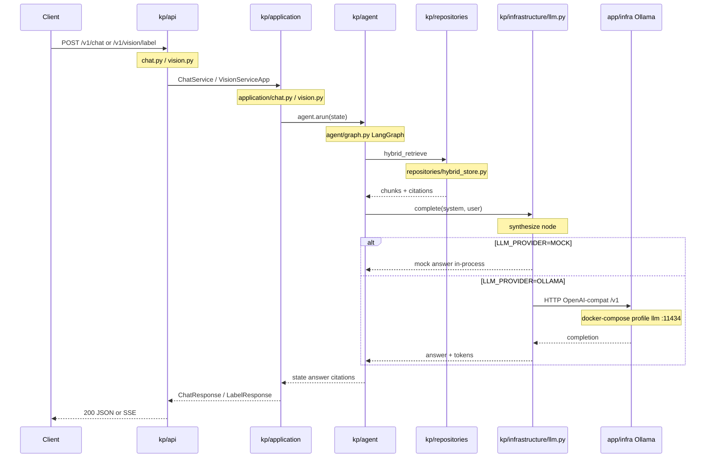
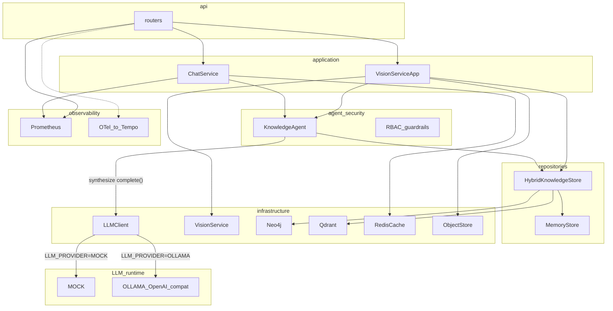

# Backend — Knowledge Platform API

The RetailPartnerX HTTP Control Plane: GraphRAG chat with ACL, label recognition, semantic cache and observability. Model answers go through the built-in **`LLMClient`**: the backend does not depend on the LLM as a hosted service, it **calls** the model from the agent (MOCK locally / Ollama in hybrid).

Environment startup and ports are in [docs/SETUP.md](../../docs/SETUP.md). The map of all of `app/` is in [app/README.md](../README.md).

## Stack and purpose

| Technology | Role in the project |
|------------|----------------|
| **FastAPI** + Uvicorn | HTTP API (`/v1/chat`, `/v1/vision/label`, jobs, LLM config, `/health`, `/metrics`) |
| **LangGraph** | Agent orchestration: guard → retrieve → synthesize → output guard |
| **LangChain OpenAI client** | Calls Ollama through the OpenAI-compatible `/v1` |
| **Pydantic / Settings** | Request contracts and env (`LLM_PROVIDER`, `STORE_BACKEND`, store URIs) |
| **In-memory store** | Default GraphRAG index for CI/demo (`STORE_BACKEND=memory`) |
| **Neo4j** | Live graph of entities/documents in `live` mode (+ CLI sync) |
| **Qdrant** | Chunk vector search in `live` mode (+ CLI sync) |
| **Redis** | Shared semantic answer cache in `live` mode |
| **MinIO** | Raw label files and recognized JSON in `live` mode (local FS otherwise) |
| **Pillow / pypdfium2** | Image/PDF normalization before mock OCR |
| **Prometheus** | API/RAG/vision/cache/ACL metrics → Grafana KP Overview |
| **OpenTelemetry** | Request traces → Tempo (Compose `:4318`); JSON logs → Loki via Alloy |

Elasticsearch is **not used**: Qdrant plus the store's lexical rerank covers full-text and vector needs.

## How the backend connects to the LLM

A sequence across layers (paths are relative to `app/backend/`). Participants are named after the folders that hold the code.

README/GitHub previews only zoom the whole page (`Ctrl`+`+`/`-`). To **zoom the diagram itself**, open it in [Mermaid Live (zoom / pan)](https://mermaid.live/view#pako:eNp1lF1v2jAUhv_KUa46tTRl61WkISFabd1CgwjqFVLlJgewcGzPdphY1f_eY8cMSLerxD7P-fRrvyaVqjHJILH4q0VZ4R1na8OapQTQzDhecc2kg4ngSB9m41_fPtbcG7c6ZZp_NOq_Ri14xRxX8gO0jgk8tv5HitIpgxEwqJXltMHR9rlcNJHicmWYdaatXGswFaK51vs-XgjBGuY9qLjOJe4tQ41dv4PRiFrMYFaUC0h3w7TaMAfKhP8dt9RQKtgLCu_yqByC2qGB4ONRSgwpdGAsgmwhqs5gQkSJZscrJOopUHFN9n5IcjiZY_rf8NqH95Mk3n-umWnlhXXM4adezBMqpePXGx8wZ3L9zS9CuHU3hXAKGWz2L4bXzwYdHcEOz8NF5vSQ0uhgvSlWGLDBschq08qthUuouAut2dPEdKyEqEYLdHhh99ZhcwWtRdNrJoB2L90GLf-DIEnhnmCCtJFPn2fz4unh7n7-dVpMfnoDeJeTOhpVbYFJ-5uCcTnQRlVoQy0oLJ7HKPJ8PB0fo4xGnXYy-L5YzKDQKMcPA182yYW00pHHYg90TTnRBFBRDsq54gKBJAvZcHj75bZz7PBBbxzxNvX7iC1cglNb7IaJsj7O9KC-oIgDfT570tBB-V6jc7SaTF6kuRf7YX2QM7Hddcng880N_CiLR39HyvJ-KZMrSBo0DeM1vTevCR1PE16eGlesFS55I4C1TpV7WdE-XVuknVbXVF18leL22zs14Z49).



DI is assembled in [`kp/deps.py`](kp/deps.py): `AppContainer` passes `LLMClient` to `KnowledgeAgent`. Env: [`kp/config.py`](kp/config.py) (`LLM_PROVIDER`, `OPENAI_BASE_URL`, `LLM_MODEL`). Switching providers without a restart: [`kp/api/llm.py`](kp/api/llm.py) → `GET/PUT /v1/llm/config`. Metrics: [`kp/observability/metrics.py`](kp/observability/metrics.py).

| Participant in the diagram | Folder / file |
|-------------------|--------------|
| `kp/api` | [`api/chat.py`](kp/api/chat.py), [`api/vision.py`](kp/api/vision.py), [`api/llm.py`](kp/api/llm.py) |
| `kp/application` | [`application/chat.py`](kp/application/chat.py), [`application/vision.py`](kp/application/vision.py) |
| `kp/agent` | [`agent/graph.py`](kp/agent/graph.py), the `synthesize` node |
| `kp/repositories` | [`repositories/hybrid_store.py`](kp/repositories/hybrid_store.py) (+ neo4j/qdrant in `infrastructure/` in `live` mode) |
| `kp/infrastructure/llm.py` | [`infrastructure/llm.py`](kp/infrastructure/llm.py) — `LLMClient` |
| `app/infra` Ollama | [`../infra/docker-compose.yml`](../infra/docker-compose.yml), outside the API process |

## Architecture

Layers run top to bottom: thin HTTP, use cases in `application`, data through `repositories`, external systems in `infrastructure`. Metrics and traces live separately in `observability`.

Zoom/pan: [open the flowchart in Mermaid Live](https://mermaid.live/view#pako:eNqFlN1v0zAQwP8VK08gMZ54QgIpy5Co1pLRjr24U-Q619bDsSPH3hS2_e-cP5KuaREvvuR35_tOnjOua8g-k2wr9RPfM2PJ7eVaEdK5zc6wdk9YK-asB0MoPt17FSFL7SyYjpooAwVVT-61471WCs6s0CrdL_bM_iqoFyswj4JDUtyJDq1QFR-SMm_bsyG4NoDud6Bs1QF3Rtg-Oco9pNdKP0modxBeh-Qv84L6o9o5ZmrDhDxfgYFWd4QGIaw2Arrk4nu_MaKmUYxBVmgzFLKARpueRnFQTEMItTWM0CA6axy3bnQxny8KKXwZ49NRl1aP_LhNSfsD9KcHGs5EfmKR6CaKoQtQi46Gs2B8P-Yt1Kyk5eYBuP132lI2S6esaLD9mFxl4svgQ_PfSOmiLK4TKqVkDaPlfJ4v8qpsQeWziuumZfZsAL3BxuOBhbGNkIe53hjdUH-A3YMb5lHegqTeK0pAlenfek3bSi4uvqbNm9Jh7TyPFgGHrfFs0B_TN5ahj54FZUBxOY7YyzrreoWJd-IPEF--BAvv3q-zl8O0T-KN0z7RHEIc4TBDT6M-srCIExh2ZMLikng4ZpRS94O-WZZ3s6tvyy9-tj7tNOv_2sfJ-xtxFSb98xOdDuWEfUToJ71W2QeSNWAaJmr8dz1n2NIm_MVq2DInbfaKBsxZveoVR45fFiBxbc0sXAmGS9Yk_PoXjAexJQ==).



| Layer | Responsibility |
|------|-----------------|
| `api/` | HTTP parsing → use-case call → response/SSE |
| `application/` | Chat / vision / audit orchestration |
| `domain/` | Pydantic schemas + GraphRAG nodes |
| `agent/` | LangGraph state machine; LLM call in `synthesize` |
| `security/` | Demo Bearer RBAC + input/output/vision guards |
| `repositories/` | Protocols + memory + hybrid facade |
| `infrastructure/` | Neo4j, Qdrant, Redis, MinIO, **LLMClient**, embeddings, vision |
| `observability/` | Prometheus metrics + OTel→Tempo + JSON logs→Loki |

### `memory` vs `live`

| `STORE_BACKEND` | Knowledge | Cache | Objects |
|-----------------|-----------|-------|---------|
| `memory` (default, CI) | in-process Hybrid→Memory | in-process semantic cache | local FS |
| `live` | Neo4j graph + Qdrant vectors (+ memory write-through) | Redis semantic cache | MinIO |

## Structure

```
app/backend/
├── kp/                # Python API package (not `app/` or `platform`, which conflicts with the stdlib)
│   ├── main.py              # create_app(): CORS, OTel, /metrics, startup seed
│   ├── config.py            # Settings (env / .env)
│   ├── deps.py              # AppContainer — DI
│   ├── api/                 # thin routers per domain
│   ├── application/         # chat / vision / audit use-cases
│   ├── domain/              # schemas + nodes
│   ├── agent/               # LangGraph KnowledgeAgent
│   ├── security/            # RBAC + guardrails
│   ├── repositories/        # memory + hybrid store
│   ├── infrastructure/      # Neo4j, Qdrant, Redis, MinIO, LLM, vision
│   └── observability/       # Prometheus + OTel/Tempo + JSON logs
├── pipelines/               # CLI seed / sync / ingest
├── evals/                   # golden set, eval gate, LLM judge, cache calibration
├── scripts/
├── tests/
├── openapi/
├── Dockerfile
└── pyproject.toml
```

## Runtime path

```
uvicorn kp.main:app
  → api routers + AppContainer
      → application (chat / vision)
      → KnowledgeAgent (LangGraph)
      → HybridKnowledgeStore / LLM / Vision / ObjectStore / SemanticCache
```

## Run locally

```bash
cd app/backend
pip install -e ".[dev]"
uvicorn kp.main:app --reload --port 8080
pytest -q
```

Useful Make targets (from the repo root): `make dev-mock` (API+UI, MOCK), `make dev-llm` (API+UI + Ollama), `make api`, `make seed`, `make load-smoke`.

Demo tokens (Bearer): `guest` | `associate` | `manager` | `compliance`.

## Intentionally outside the runtime

| Artifact | Why it stays |
|----------|----------------|
| `pipelines/sync_neo4j.py`, `sync_qdrant.py` | Bulk seed/demo sync (same infra methods) |
| `pipelines/ingest_ruslaw.py` | Optional ingest |
| `openapi/*.yaml` | Contract/boundary; FastAPI generates `/docs` separately |
| `postgres_dsn` / `jwt_secret` in Settings | Helm env contract / roadmap |

Local `*.egg-info/` is a `pip install -e` artifact and is already in `.gitignore`.
