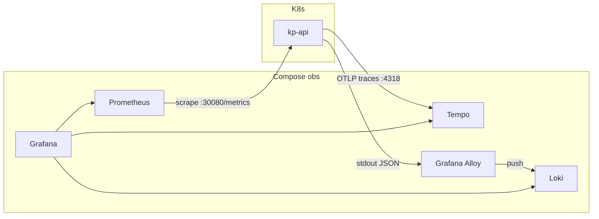

# ADR-006: Observability

## Status

Accepted

## Context

The project defense and operations need under-the-hood traces (OTel), token and latency metrics (Prometheus/Grafana), centralized logs (Loki) and a decision audit for FinOps (linked to hw-10).

## Selection criteria

- End-to-end OpenTelemetry request tracing
- LLM / RAG / vision metrics
- Trace ↔ log correlation in one UI
- Self-hosted stack in Compose
- No SaaS-only dependencies (Langfuse Cloud is optional)

## Options

| Option | Pros | Cons |
| ------ | ---- | ---- |
| **OTel → Tempo + Loki + Prom/Grafana (LGTM)** | Single Grafana hub, air-gap, traces↔logs | Requires instrumentation and JSON log discipline |
| OTel → Jaeger + Prom/Grafana | Simple trace UI | Separate UI; no logs in the stack |
| Langfuse self-hosted | Convenient LLM traces | One more service |
| Logs only | Simple | Too weak for the defense |

## Decision

- OpenTelemetry → **Tempo** (`FastAPIInstrumentor.instrument_app`, OTLP/HTTP `:4318/v1/traces`)
- **Loki**: API JSON stdout + **Grafana Alloy** (Docker socket) → push; Grafana Explore
- Prometheus: `llm_tokens_total`, `rag_latency_ms`, `vision_latency_ms`, `semantic_cache_hit_rate`, `kp_requests_total`, `acl_denies_total`
- Grafana: Prometheus / Tempo / Loki datasources + provisioned **KP Overview** dashboard (`app/infra/grafana/provisioning/`)
- Hybrid scrape: `host.docker.internal:30080/metrics` (API NodePort)
- Audit rows with a FinOps `cost_est` field

## Consequences

- (+) Trace and log demo at the defense; shared language with SRE; correlation in Grafana Explore
- (−) Span completeness depends on code coverage; dashboards are a starter set; Alloy needs the Docker socket

## References

- `app/backend/kp/main.py`, `app/backend/kp/observability/metrics.py`, `app/backend/kp/observability/logging_json.py`
- Compose profile `obs` (tempo, loki, alloy, prometheus, grafana)
- Ops: [docs/infra/compose-dev.md](../../docs/infra/compose-dev.md)
