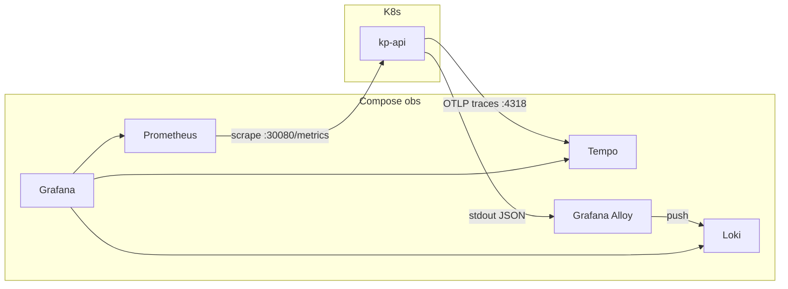

# ADR-006: Observability

## Статус

Accepted

## Контекст

Для защиты и ops нужны трейсы «под капотом» (OTel), метрики токенов и latency (Prometheus/Grafana), централизованные логи (Loki) и audit решений для FinOps (связь с hw-10).

## Критерии выбора

- OpenTelemetry tracing end-to-end запроса
- Метрики LLM / RAG / vision
- Корреляция traces ↔ logs в одном UI
- Self-hosted стек в compose
- Не тянуть SaaS-only (Langfuse cloud опционален)

## Варианты

| Вариант | Плюсы | Минусы |
| ------- | ----- | ------ |
| **OTel → Tempo + Loki + Prom/Grafana (LGTM)** | Единый Grafana hub, air-gap, traces↔logs | Нужна дисциплина instrumentation + JSON logs |
| OTel → Jaeger + Prom/Grafana | Простой UI трейсов | Отдельный UI; нет logs в стеке |
| Langfuse self-host | Удобные LLM traces | Ещё один сервис |
| Только логи | Просто | Слабо для защиты |

## Решение

- OpenTelemetry → **Tempo** (`FastAPIInstrumentor.instrument_app`, OTLP/HTTP `:4318/v1/traces`)
- **Loki**: JSON stdout API + **Grafana Alloy** (Docker socket) → push; Grafana Explore
- Prometheus: `llm_tokens_total`, `rag_latency_ms`, `vision_latency_ms`, `semantic_cache_hit_rate`, `kp_requests_total`, `acl_denies_total`
- Grafana: datasources Prometheus / Tempo / Loki + provisioned dashboard **KP Overview** (`app/infra/grafana/provisioning/`)
- Hybrid scrape: `host.docker.internal:30080/metrics` (API NodePort)
- Audit rows с FinOps-полем `cost_est`

## Последствия

- (+) Демо трейсов и логов на защите; единый язык с SRE; корреляция в Grafana Explore
- (−) Полнота spans зависит от покрытия кода; дашборды — starter; Alloy нужен Docker socket

## Ссылки

- `app/backend/kp/main.py`, `app/backend/kp/observability/metrics.py`, `app/backend/kp/observability/logging_json.py`
- Compose profile `obs` (tempo, loki, alloy, prometheus, grafana)
- Ops: [docs/infra/compose-dev.md](../../docs/infra/compose-dev.md)
