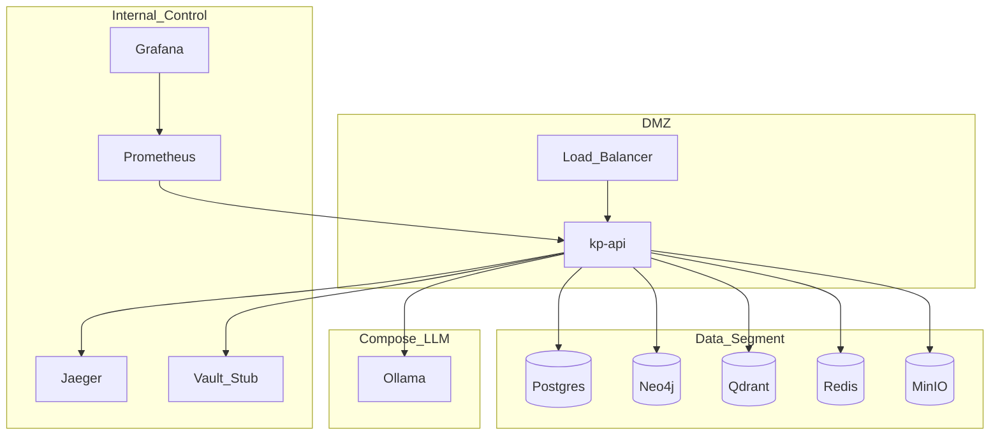

# Deployment — физическое размещение

**Схема (Draw.io):** [deployment.png](diagrams/deployment.png) · [deployment.drawio](diagrams/deployment.drawio)

## Назначение

Сегментация сети (DMZ / Internal Control / Data / GPU), балансировка, секреты, учёт GPU для on-prem LLM.

## Сегменты

| Сегмент | Состав |
| ------- | ------ |
| DMZ / Edge | Load Balancer → `kp-api` |
| Internal Control | Prometheus, Grafana, Jaeger, Vault (stub) |
| Data | Postgres, Neo4j, Qdrant, Redis, MinIO |
| LLM (Compose) | Ollama (`qwen2.5:0.5b`) / MOCK |

## Секреты и LLM

- **Secrets:** Vault file stub / env — никогда в образах.
- **LLM:** Ollama на хосте (hybrid) или MOCK ([ADR-001](adr/ADR-001-llm-serving.md)).

K8s (Docker Desktop / kind): [docs/infra/k8s-architecture.md](../docs/infra/k8s-architecture.md).
