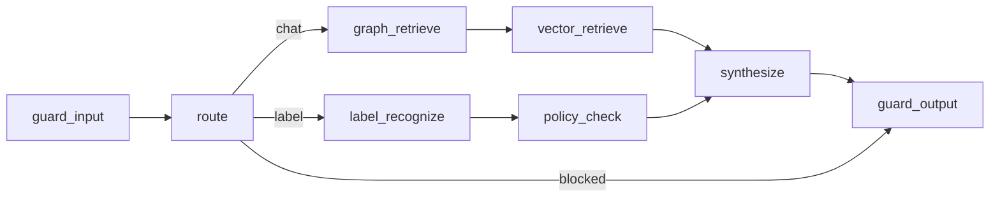

# C4 Level 3 — Agent Components

**Diagram:** [c4-backend-components.svg](../diagrams/images/c4-backend-components.svg) · workflow: [agent-workflow.svg](../diagrams/images/agent-workflow.svg)

## Purpose

Internal structure of the Knowledge Platform orchestrator: Memory, Planner (route), Tools, Synthesizer and Guardrails, following the course's Agent Component view requirement.

## Components

| Component | Responsibility | Data ownership |
| --------- | --------------- | ---------------- |
| Memory (session / audit) | Session history, audit decision | Postgres + in-memory audit |
| Planner / route | chat vs label vs blocked | State LangGraph |
| Tools | graph_retrieve, vector_retrieve, label_recognize, policy_check | Neo4j/Qdrant/MinIO mirror |
| Synthesizer | Answer generation through LLMClient | Prompt + citations |
| Guardrails | PII, injection, ACL leak check | Role policy |

Code: `app/backend/kp/agent/graph.py`. Continuity: SRP from hw-3 (Policy Analyst → `policy_check`).
