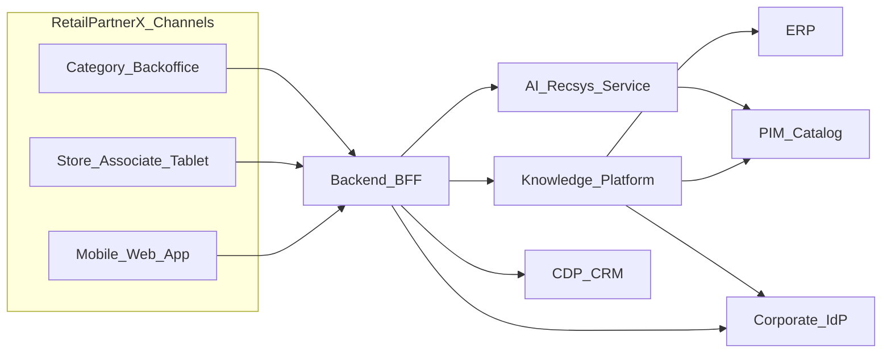

# C4 Level 1 — System Context

**Diagram:** [c4-context.svg](../diagrams/images/c4-context.svg)

## Purpose

The RetailPartnerX Knowledge Platform fits into the retailer's enterprise landscape: store channels and the back office connect through a BFF, and the platform integrates with PIM, ERP, CDP/CRM and the corporate IdP. A separate recommendation service (hw-2) exists, and the boundary with it is kept through OpenAPI.

## Actors and External Systems

| Participant | Role |
| -------- | ---- |
| Mobile/Web App, Store Tablet, Category Backoffice | User channels |
| Backend BFF | Single entry point for channels; unaware of ML details |
| Knowledge Platform | GraphRAG, labels, ACL, on-prem LLM |
| AI Recsys Service | Personalized recommendations (external to KP) |
| PIM / ERP / CDP / IdP | Catalog, operations, profile, authentication |

## Trust boundary

The BFF calls the Knowledge Platform only through OpenAPI (`/v1/chat`, `/v1/vision/label`). LLM, graph and vector internals are not exposed to channels.

