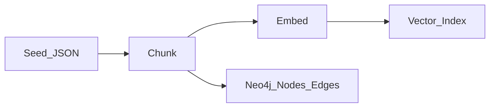
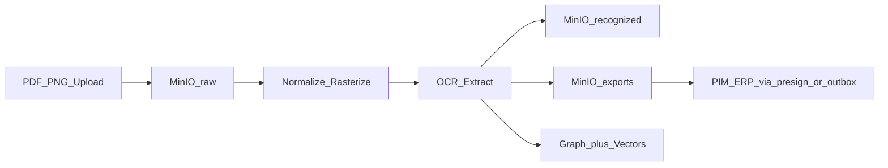

# Data Flow

**Diagram:** [data-flow.svg](../diagrams/images/data-flow.svg)

> A mandatory artifact under the course criteria (a missing Data Flow is grounds for rejection).

## Text ingest (policies / KB)

Seed JSON (including a Russian law sample) → chunk → embed → Vector Index; in parallel, nodes/edges go to Neo4j (and the in-memory mirror for the MVP runtime).

## Label ingest + handoff

Upload PDF/PNG → MinIO `raw/` → normalize/rasterize → OCR extract → `recognized/` + `exports/` → Graph + Vectors → PIM/ERP through presign / outbox `label.recognized`.

## Chat query path (summary)

Request → Input Guard → (Semantic Cache) → Graph resolve → Vector+ACL → LLM → Output Guard → Audit → SSE/JSON.

See [sequence-chat.md](sequence-chat.md).
