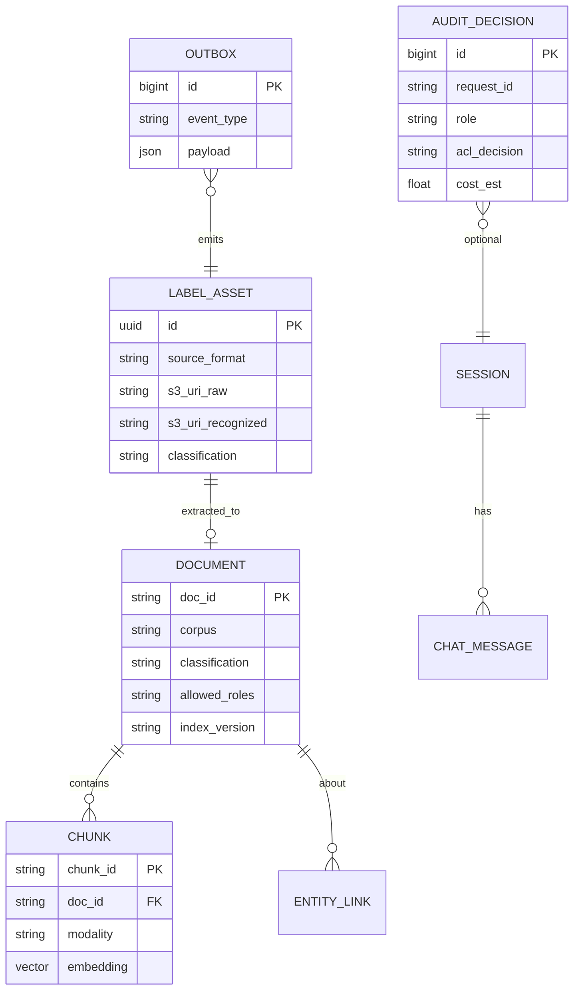

# ER / Data Model

**Diagram (intended DDL):** [er-conceptual.svg](../diagrams/images/er-conceptual.svg)

## Purpose

Storage of documents, chunks (vectors), labels, sessions, audit and outbox; RBAC through `classification` + `allowed_roles`.

## Entities

| Entity | Key fields |
| -------- | ------------- |
| Document | corpus, classification, allowed_roles, index_version |
| Chunk | embedding, modality, doc_id |
| LabelAsset | s3_uri_raw / recognized, classification |
| Session / ChatMessage | dialog history |
| AuditDecision | request_id, role, acl_decision, cost_est |
| Outbox | event_type (`label.recognized`), payload |

Graph ontology (nodes/edges): [ADR-003](adr/ADR-003-graph-db.md).

