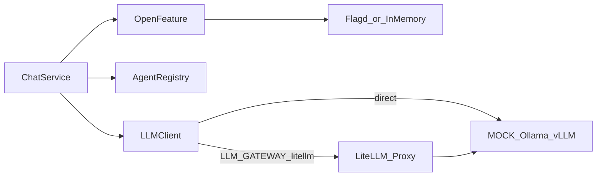

# GenAI gateway (LiteLLM)

Optional GenAI gateway owned by this platform. The **closed perimeter remains the default** (`LLM_GATEWAY=direct`): the API talks to MOCK / Ollama / vLLM via [`LLMClient`](../../app/backend/kp/infrastructure/llm.py). Turning on `LLM_GATEWAY=litellm` puts a **LiteLLM proxy** on that path for routing, failover, and metering without leaving the local profile unless you explicitly load the multiprovider config.

ADR: [ADR-012](../../architecture/adr/ADR-012-genai-gateway.md).

## Request path



| Hop | Role |
| --- | ---- |
| ChatService | Authorizes the agent (registry + kill-switch flags), then calls the LLM |
| OpenFeature / Flagd | Progressive `model_route` / `prompt_version`; emergency `kill_switch_agents` |
| AgentRegistry | Declarative manifest (Phase 1) |
| LLMClient | OpenAI-compatible HTTP client; `direct` or `litellm` |
| LiteLLM_Proxy | Aliases, failover, token metering toward local (or demo cloud) backends |

## Profiles

| Profile | `LLM_GATEWAY` | Backends | Status |
| ------- | ------------- | -------- | ------ |
| closed (default) | `direct` | MOCK / Ollama / vLLM | Supported |
| `gateway-local` | `litellm` | Same local backends via LiteLLM | **Verified** on desktop: Compose `litellm` + `LLMClient` (`chat-mock`; `chat-default` → mock failover without Ollama). Live Ollama primary path: start `--profile llm` (not exercised in that run) |
| `gateway-multiprovider` | `litellm` | Local + Azure / Vertex / Bedrock stubs | Config only — **live cloud not verified** |

## Run gateway-local (desktop)

From `app/infra`:

```powershell
docker compose --profile gateway --profile llm up -d litellm-db litellm ollama
```

Admin UI: `http://127.0.0.1:4000/ui` (user `admin`, password = `LITELLM_MASTER_KEY` / `sk-kp-local-gateway`).  
Swagger / OpenAPI: `http://127.0.0.1:4000/` (needs a responsive proxy — if `/ui` hangs without DB, OpenAPI can time out too).

The gateway Compose profile starts **Postgres** (`litellm-db`). Without `DATABASE_URL`, `/get/ui_settings` returns 500 (`Database not connected`) and the Admin UI stays on loading. A 404 on `/ui/litellm-runtime-config.json` is normal in the single-host image (UI falls back to same-origin).

API env (see [`.env.example`](../../.env.example)):

```env
LLM_GATEWAY=litellm
LITELLM_BASE_URL=http://127.0.0.1:4000/v1
LITELLM_MODEL_ALIAS=chat-default
LITELLM_API_KEY=sk-kp-local-gateway
LLM_TEAM_ID=platform
```

Config files:

- [`app/infra/litellm/config.gateway-local.yaml`](../../app/infra/litellm/config.gateway-local.yaml) — `chat-default` (Ollama + mock failover), `chat-mock`
- [`app/infra/litellm/config.gateway-multiprovider.yaml`](../../app/infra/litellm/config.gateway-multiprovider.yaml) — same locals + commented cloud stubs

CI does **not** require the LiteLLM container; unit tests mock/assert the client binding.

## Metering / attribution

Audit rows (`/v1/audit` store) and Prometheus `llm_tokens_attributed_total` include:

- `agent_id`, `team_id`, `gateway` (`direct` \| `litellm`)
- `model_route`, `prompt_version`, `flag_variant` (from feature flags)
- `cost_est` (heuristic token × rate, same as before)

## Failover

`chat-default` lists Ollama first and a `mock_response` sibling deployment for LiteLLM retries. Desktop check (proxy up, Ollama down): `chat-default` returned the `[gateway-failover]` mock sibling. Primary Ollama hop still needs `--profile llm` + a pulled model.

## Related

- Agent registry: [agents.md](./agents.md)
- Feature flags / kill-switch: [feature-flags.md](./feature-flags.md)
- Roadmap: [agent-platform-roadmap.md](./roadmap.md)
