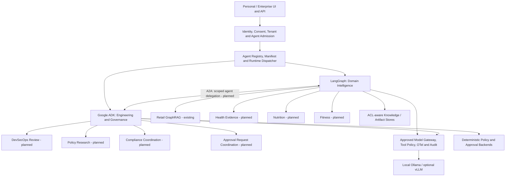

# Multi-Domain Agent Platform: Domain Intelligence + Engineering & Governance

> **Status: proposed architecture / roadmap, not a claim of deployed capabilities.**
> Current working reference: RetailPartnerX GraphRAG on LangGraph. Google ADK, cross-runtime A2A, healthcare-specific modules, and most cross-domain workflows are **planned**. Preserve the existing RetailPartnerX name and working use case until a separate product decision warrants rebranding.

## Product direction and boundaries

Evolve the retail-focused knowledge platform into a **domain-agnostic, secure, self-hosted agent platform** supporting distinct applications for everyday needs (food, health education/wellness, fitness) and organizational needs (retail knowledge, policy, compliance, DevSecOps). The *platform* provides reusable contracts; *domain products* own their user journeys, policy rules, data classifications, datasets and evaluations. This is not a commitment to build every proposed product simultaneously.

Two possible product surfaces may reuse the same core:
- **Personal Life Assistant (future):** food-product evidence, general nutrition, exercise planning and educational health information, without autonomous diagnosis, treatment or clinical decisions.
- **Enterprise Agent Platform (future):** regulated-access retail, organizational policy, engineering governance and eventually healthcare enterprise workflows with separate tenant/data boundaries.

## Runtime specialization: design preference, not a framework restriction

| Track | Preferred initial runtime | Example agents / capabilities | Current state |
| --- | --- | --- | --- |
| **Domain Intelligence** | **LangGraph** | Retail GraphRAG; Health Evidence Workflows; Nutrition Assistant; Fitness Planner | Only Retail GraphRAG exists. Others planned |
| **Engineering & Governance** | **Google ADK** | DevSecOps Reviewer; Compliance Pipelines; Approval Workflows; Policy Research Agent | Planned; ADK is not shipped |
| **Cross-track interoperability** | **A2A** between independently deployed agents | Approved task delegation, discovery, status/artifacts and structured evidence | Planned; A2A is not currently implemented |

These are **organizational defaults** based on the first useful reference use cases, not intrinsic capabilities or benchmarks of either framework. Both LangGraph and Google ADK support tools, workflow control and agent coordination. Choose a runtime **per registered agent** based on tested requirements, state model, recovery, team ownership and operational constraints. Do not imply ADK is always faster or LangGraph always more secure.

- Keep the existing fixed **LangGraph Retail GraphRAG** intact; never rewrite it merely to showcase ADK.
- Run **Google ADK locally** as a distinct, bounded Python agent service/container via existing approved model routes and the LiteLLM gateway where enabled; no implicit Gemini/Vertex/cloud egress.
- Common **AgentManifest / Registry / Dispatcher** manage registration, approved runtime entrypoints and API-facing contracts. Framework-specific internal state and checkpoints stay isolated; no hot-swapping active sessions or automatic checkpoint migration.
- The existing governance/quality roadmap remains cross-cutting. A LangGraph domain agent can call approved tools directly; ADK agents can use deterministic policy engines. The track names are not authorization roles or security boundaries.
- A2A is for **independent agent systems** and justified cross-service delegation; not for every intra-workflow node call. MCP may expose scoped tools independently of A2A. Existing SSE remains canonical unless an AG-UI adapter proves useful.

## Target topology

Diagram depicts the **intended logical topology**; modules and network boundaries are proposals, not running services. A2A agents exchange scoped tasks and evidence, **not unrestricted data or each other's native internal memory**.

## Reference A2A slice 1: engineering policy review for a retail integration (recommended first)

**Use case:** an engineer requests a read-only security/compliance review of a proposed supplier API integration.

1. **Google ADK DevSecOps Reviewer** receives a scoped request: sanitized API contract, non-secret deployment configuration, and authenticated actor/tenant context.
2. It discovers the **LangGraph Retail Knowledge Agent** through an approved A2A Agent Card / registry mapping. An adapter exposes Retail GraphRAG over the A2A contract; this is **new work**.
3. The reviewer delegates a **read-only evidence lookup**. LangGraph enforces document ACL **under the delegated user's effective permissions** and returns cited retail/supplier policy excerpts and provenance, not raw tenant data by default.
4. ADK checks the submitted config, optionally invokes authorized read-only checks and a deterministic policy engine, then returns structured **findings, severity, source citations, uncertainty and recommendations**.
5. Platform logs correlation/task IDs, runtime identities, authorization decisions, costs and sanitized traces. No configuration writes occur. A failed delegation results in explicit `unavailable / inconclusive`, not a false pass.

**Proof:** two separately runnable services and manifests; reachable Agent Cards; actual A2A task with ID/status/artifact, auth-denial and cross-tenant negative tests; bounded timeout/cancellation, trace propagation and gateway failure case. Merely invoking another Python function or REST endpoint without implementing the A2A protocol **does not count** as A2A.

**Do not depend on A2A for local calls** that remain inside one agent/service. Begin with one remote delegation; add no coordinator fleet solely for a diagram.

## Reference slice 2: Food → Nutrition → Fitness, with optional policy review

**Use case:** a person asks for food suggestions and an activity-oriented menu, with self-declared dietary constraints.

- **LangGraph Retail GraphRAG** grounds product ingredients and allergen information in permitted documents and labels, including freshness/provenance and uncertainty.
- **LangGraph Nutrition Assistant** proposes informational meal options consistent with user-declared preferences; it must not invent verified allergen safety or clinical nutritional suitability.
- **LangGraph Fitness Planner** can use non-medical activity goals and explicitly provided constraints for general exercise guidance.
- **Health Evidence Workflow** retrieves reputable educational evidence with citations if needed; no autonomous diagnosis, prescriptions or treatment claims.
- A **Google ADK Policy Research/Compliance Agent** may be consulted via A2A **only** when the scenario actually requires an organizational/compliance review, not by default. Deterministic validation remains outside the LLM where a clear rule is available.

For a minimal local demo, use synthetic non-identifying user profiles, fictional product catalog data with explicit labels, no live medical records, and a single real cross-system delegation if needed. Cross-domain data access must remain opt-in and scoped.

## Security and healthcare-readiness requirements

**Do not treat a wellness demo as a healthcare product or a certified clinical system.** Before handling personal health information or deploying to a clinical context, perform a use-case-specific legal, safety and security assessment (e.g., GDPR, applicable French HDS hosting rules, EHDS rollout and medical-device/AI obligations as relevant). Compliance claims require external evidence.

- **Separation:** tenant, organization, purpose, user consent and data classification boundaries; no implicit transfer from personal Health to Retail, DevSecOps or enterprise agents.
- **Identity:** signed/authenticated caller and agent identity; narrowly delegated scopes, allowlisted tools and per-resource ACL at every retrieval and execution. Agent Cards are discovery metadata, not proof of trust.
- **Sensitive data:** encrypted storage/transit, redacted logs/traces, Vault/ESO credential lifecycle, data minimization, deletion/export/retention requirements and durable audit evidence.
- **Clinical safety:** general educational/wellness scope first; reliable citations, uncertainty handling, escalation to qualified professionals for clinical decisions, safety evaluations on red flags and permission refusals.
- **Interoperability:** evaluate HL7 FHIR only when there is a concrete, permitted healthcare-data integration use case; do not build FHIR just to match an employer's stack.
- **Actions:** ADK can propose findings, policy assessments and approval requests; an independent trusted backend verifies approver identity, action binding and current permissions before any sensitive mutation. Deterministic compliance decisions must not rely solely on an LLM.

## Evaluation and performance: compare before choosing

Benchmark **equivalent tasks** with the same local model, prompt/tool/data budgets and hardware. Record p50/p95 end-to-end latency, tool/LLM calls, tokens, retrieval latency, output quality, ACL safety, cost estimate, recovery time and failure rate. Identify A2A network hop overhead and policy enforcement cost explicitly. Do not attribute differences in inference model or number of calls to runtime speed.

Test contract compatibility (manifest/API, A2A task/result), timeouts, transient outages, denied access, rate limiting, replay/idempotency and negative health-safety cases. Avoid adding a second framework or protocol unless the interoperability gain outweighs complexity.

## Incremental delivery / priority

1. **P0 — preserve and harden foundation:** current GraphRAG, security, LiteLLM/Flagd live smoke and engineering evidence (Roadmap Phase 4).
2. **P1 — real second runtime:** minimal local Google ADK **read-only Policy/DevSecOps Reviewer** with platform registry, gateway and OTel contracts; establish two independent deployed systems (Phase 5).
3. **P1/P2 — A2A vertical slice:** bridge ADK reviewer to LangGraph Retail GraphRAG for one authorized supplier-policy lookup; measure success, failure and latency (Phase 8). A2A need not wait for unrelated UI interoperability features.
4. **P2 — domain expansion:** synthetic-data Nutrition and Fitness workflows on LangGraph, plus optional Health Evidence; add one Food/Nutrition/Fitness end-to-end evaluation. Keep user journeys narrow.
5. **Later / separate gate:** health-data interoperability, patient consent workflows and regulated clinical use only after explicit product scope, privacy/legal assessment, and security/safety validation.

Status is `planned` until code exists, and `verified` only after reproducible test evidence. Keep each new capability tied to requirements, acceptance criteria and corresponding capability-map status. No implementation tasks or Cursor prompts are created by this document.
