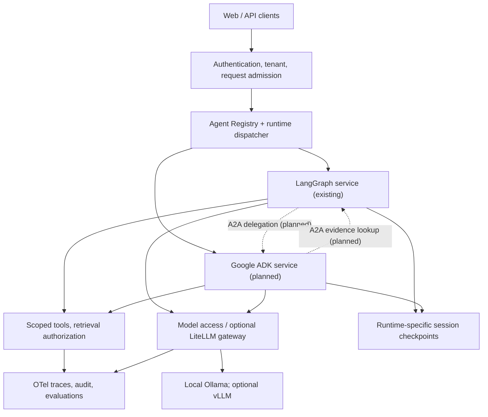
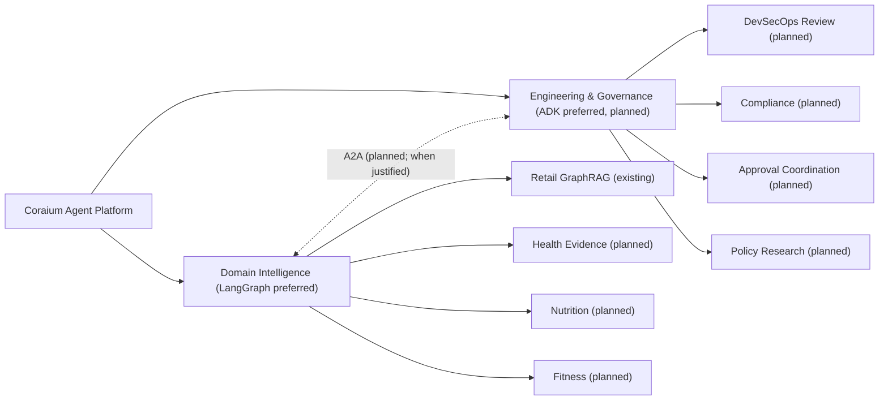
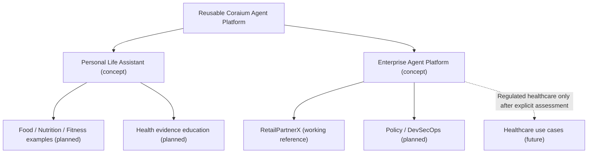

# Coraium Agent Platform — Public Architecture Views

> **Logical future-state designs, not an inventory of running services.** The only implemented reference agent is RetailPartnerX GraphRAG on LangGraph. Google ADK, A2A, and most new domain agents are **planned**. These inline Mermaid illustrations describe intended architecture; do not manually edit generated Structurizr/C4 output under `architecture/diagrams/`.

## View 1 — Platform overview



No checkpoint/state migration is implied by the shared dispatcher or A2A connections. Admission and tool boundaries must independently enforce permission checks.

## View 2 — Domain map



The track-to-runtime match is a **starting specialization, not a framework or security lock**. Approvals and formal policy decisions require trusted backends outside LLM discretion.

## View 3 — First reference interoperability sequence

```mermaid
sequenceDiagram
  actor Engineer
  participant API as Coraium API / Identity
  participant ADK as ADK DevSecOps Reviewer (planned)
  participant A2A as A2A boundary (planned)
  participant LG as LangGraph Retail GraphRAG (existing core)
  participant KB as ACL-aware Knowledge Stores
  Engineer->>API: Review supplier integration (read-only)
  API->>ADK: Authorized review context
  ADK->>A2A: Discover Agent Card / delegate scoped evidence lookup
  A2A->>LG: A2A task + delegated identity + deadline
  LG->>KB: Permission-filtered policy retrieval
  KB-->>LG: Cited policy evidence
  LG-->>A2A: Task result + citations / provenance
  A2A-->>ADK: Scoped results or explicit failure
  ADK-->>API: Findings, uncertainty, audit references
  API-->>Engineer: Review only; no automatic configuration write
```

**Required proof before "implemented":** separate running services and manifests, real A2A task IDs and Agent Cards, denied access tests, failure/deadline behavior, end-to-end trace correlation. API and dataset isolation for health data is not demonstrated by this sequence.

## View 4 — Product surfaces



For implementation states, limits, privacy/health-safety gates, and sequencing, read [multi-domain architecture](./multi-domain-architecture.md) and [capability map](./capabilities.md).
