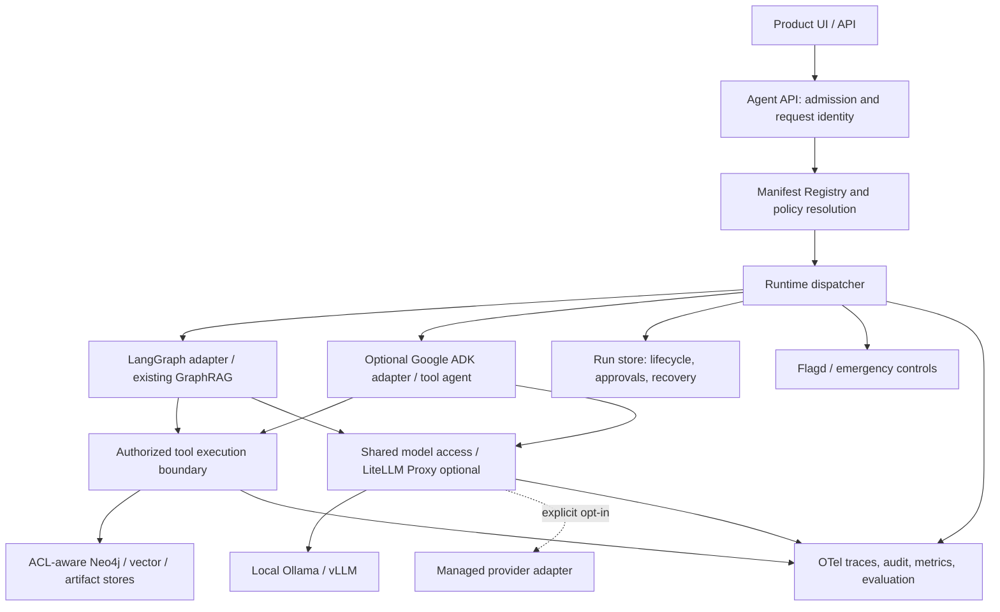

# Coraium Agent Platform Roadmap

A pragmatic plan to evolve **Coraium Agent Platform**, whose first working reference application is **RetailPartnerX Knowledge Platform**, into a **secure, self-hosted, multi-runtime Agents Platform**. This is a reusable engineering portfolio, not a clone of a single employer's technology stack.

The existing course GraphRAG use case remains operational. New capabilities must reuse proven components, stay testable on a laptop, and demonstrate concrete platform contracts, security, recovery, and developer experience.

For the multi-domain direction and LangGraph/ADK/A2A responsibilities, see the [multi-domain architecture](./multi-domain-architecture.md), [public architecture views](./public-architecture.md), and [open-source strategy](./open-source-strategy.md). For related source-of-truth documents, see the [capability map](./capabilities.md), [Engineering Excellence standards](./engineering/README.md), and [specification/delivery workflow](./delivery-workflow.md). These capture document intelligence (RapidOCR/optional Docling), Vault/ESO verification, Python/TypeScript/Go engineering quality, algorithmic reasoning and lightweight OpenSpec-compatible requirements without adding a new mandatory toolchain.

## Principles and scope

| Principle | Decision |
| --- | --- |
| Framework-agnostic platform | One external agent API and declarative manifest; **LangGraph** is the existing runtime and **Google ADK** is an optional second runtime |
| Runtime choice | Choose a runtime per agent at registration/invocation. Do **not** promise checkpoint or workflow portability between frameworks |
| Closed LLM perimeter | Default to MOCK / Ollama (CPU) / self-hosted vLLM (GPU when available). LiteLLM Proxy is optional; external providers are explicit opt-in, never the default |
| Reuse before adding | Preserve Neo4j + vector RAG, PostgreSQL, Celery/Redis ingestion, Keycloak + Go BFF, OTel/LGTM, Helm and existing CI evaluations |
| Security boundary | Authorize at admission **and** before tool execution; distinguish a manifest declaration from enforced sandbox/network policy |
| Evidence | **Configured ≠ tested ≠ runtime-verified ≠ production-ready.** Never claim scale, safety, compliance or failover without measurements |
| Incremental delivery | One end-to-end reference-agent slice before extra protocols, control planes or cloud adapters |
| Documentation | Keep ADRs, architecture diagrams, README and presentation claims aligned with actual implementation; do not hand-edit generated diagrams |
| Deliverables | Public portfolio and reproducible local demo; a demo video and cloud infrastructure are optional |

**Explicit non-goal:** implementing every vendor tool mentioned in one job description. Prefer portable engineering capabilities and explain substitute technologies.

## Current baseline (main branch)

The entries below describe code and documentation, **not necessarily a live integration test**.

| Capability | Current evidence | Limit / next proof |
| --- | --- | --- |
| GraphRAG reference agent | Fixed LangGraph workflow, ACL-filtered Neo4j/vector retrieval, citations; existing evaluation gate | Fixed workflow is not a planning/reflection agent |
| AgentManifest and Registry | Pydantic/YAML manifests, disk and in-memory API registry; LangGraph invoke via ChatService; [ADR-011](../../architecture/adr/ADR-011-agent-manifest-registry.md) | Manifest tools, sandbox, model, memory and entrypoint are not all enforced as generic runtime bindings; registration is in-process |
| Gateway | Direct client plus LiteLLM Proxy profiles and per-agent/team attribution; [ADR-012](../../architecture/adr/ADR-012-genai-gateway.md). Desktop proxy + mock aliases verified (`/v1/models`, `chat-mock`, `chat-default` mock failover) | Live Ollama as primary behind the proxy and usage correctness still need evidence; mock fallback must not impersonate grounded KB answers |
| Feature flags | Flagd OFREP/in-memory, model/prompt variants, start-of-run kill-switch and audit; [ADR-013](../../architecture/adr/ADR-013-feature-flags.md) | Verify live Flagd and fail-safe behavior; active-run cancellation/rechecks not yet demonstrated |
| State and background work | LangGraph session checkpoints (PostgreSQL in live mode); Celery for **document ingestion** | Checkpoints do not alone guarantee idempotent durable agent jobs, approval, or resume APIs |
| Identity and security | Role-based retrieval ACL; optional Keycloak + Go BFF; Kubernetes hardening, secrets options and audit | Separate agent/delegated identity, tool authorization, retention, durable audit and sandbox enforcement still need work |
| Observability and evaluation | OTel → Prometheus/Grafana/Loki/Tempo; deterministic golden-set and ACL CI gate; optional DeepEval wiring | Agent/tool-span conventions and trace→review→eval feedback loop not yet demonstrated; real-model judge results not recorded |
| Reference agents | `graphrag-chat` is invokable; `label-assistant` is registered but has a separate vision API/stub invoke | Prove a second agent using shared platform contract, not merely a second manifest |
| K8s and IaC | Docker/Compose, Helm, local K8s hardening; AWS Terraform materials | No verified CRD/operator, cloud production cluster, or multi-cloud operation |

**Baseline verification gate:** rerun tests, diagrams drift check and local integration smoke tests after each phase. Keep setup instructions and failure evidence alongside success evidence.

## Multi-domain product direction (proposed)

The platform must become **domain-agnostic** without discarding RetailPartnerX. The preferred initial specialization is **LangGraph / Domain Intelligence** (existing Retail GraphRAG; proposed Health Evidence, Nutrition and Fitness) and **Google ADK / Engineering & Governance** (proposed DevSecOps Review, Policy Research, Compliance Coordination and Approval Requests). This is an **organizational default, not a framework limitation or a claim of runtime superiority**. Every agent selects its own runtime by manifest and measured functional/operational needs.

**A2A** will provide real, authorized **inter-service** delegation between independently deployed LangGraph and ADK agents, rather than replacing ordinary local function/tool calls. The first useful scenario is an ADK read-only DevSecOps reviewer requesting supplier-policy evidence from LangGraph Retail GraphRAG. A second demonstration may connect Food, Nutrition and Fitness, with optional policy research; do not transmit sensitive health data to unrelated agents. Keep the same security, model gateway, observability and evaluation infrastructure for both tracks. Details, target topology, healthcare safety boundaries, tests and rollout stages: [multi-domain architecture](./multi-domain-architecture.md).

**Product scope:** a future Personal Life Assistant may cover food, fitness and health education; enterprise applications may cover retail and engineering governance. Healthcare clinical functionality, patient data integrations, medical-device claims and regulated deployment are **not** in the initial MVP; assess regulatory and safety requirements before any such expansion. Initial demos use synthetic data.

## Target architecture

The diagram is a **target**, not a deployed topology. A runtime adapter is a contract for invocation and events; LangGraph and ADK retain their own internal execution semantics. Common platform policy must not depend on framework-specific prompt instructions.

### Minimal shared contracts

- **Agent definition:** immutable `agent_id` + manifest version, runtime type, approved entrypoint, tools, model alias, data classification and permissions.
- **Invocation:** principal/delegation context, request/session/run IDs, input, deadline, idempotency key and runtime selection **from the registered manifest**.
- **Result/events:** normalized status and streaming envelope (start, progress/tool event, approval required, completed, failed); preserve native runtime metadata without pretending identical internal state.
- **Control:** authorize, cancel, stop, resume and flag-check at well-defined boundaries; fail predictably on unsupported capabilities.
- **Observability:** common trace/correlation IDs, agent and manifest versions, model route, tool outcome, latency, token usage, security decision; scrub sensitive data.
- **Persistence:** runtime-specific checkpoints behind adapters plus a platform-owned run ledger; do not deserialize ADK state as LangGraph state or vice versa.

**Important:** switching `runtime: langgraph` to `runtime: adk` is not a conversion tool. Implement a different compatible agent behind the same platform API and compare outcomes on shared evaluation cases. Existing sessions stay bound to their original runtime/version.

## Delivery plan (capabilities before technologies)

Each phase needs an ADR when a real trade-off warrants one, executable tests, documented limitations and a reproducible demonstration. Phases **1–3 already exist in code**; remaining phases are planned, not delivered.

### Foundation already implemented — Phases 1–3

- **Phase 1 / [ADR-011](../../architecture/adr/ADR-011-agent-manifest-registry.md):** manifest schema, Registry, discovery, basic authorization and current LangGraph invoke.
- **Phase 2 / [ADR-012](../../architecture/adr/ADR-012-genai-gateway.md):** direct/LiteLLM configuration, local aliases, route/usage attribution. Desktop LiteLLM Compose (`gateway` profile) + `LLMClient` is **verified** (`/v1/models`, `chat-mock`, `chat-default` mock failover). Live Ollama as primary behind the proxy remains **not verified** until `--profile llm` is exercised.
- **Phase 3 / [ADR-013](../../architecture/adr/ADR-013-feature-flags.md):** in-memory/Flagd evaluation, start-of-run kill-switch, flags and audit fields. **Failure policy and mid-run enforcement need verification**.

### Phase 4 — Harden the first end-to-end platform slice (P0)

**Goal:** manifest registration causes real, policy-enforced execution of the existing GraphRAG agent; the local infrastructure can be reproduced.

- Run and record the actual LiteLLM + Ollama + Flagd Compose path, including an unavailable dependency.
- Eliminate shared mutable per-request model routing; demonstrate concurrent request isolation and correct attribution.
- Validate manifest versions, explicit approved runtime/entrypoints, model aliases and tool allowlists. Distinguish configuration validation from enforcement.
- Implement a consistent runtime admission/auth policy and prohibit unauthorized tool execution. Enforce the closed-provider allowlist across gateway profiles and observable egress.
- Define emergency-control fallback semantics on Flagd timeout/outage; distinguish disabling new runs from stopping in-flight dangerous tool actions.
- Remove or explicitly mark demo-only mock-model failover so it never returns fabricated corporate KB facts as a grounded success.
- Refresh test evidence, [gateway](./genai-gateway.md), [flags](./feature-flags.md), security ADR and diagrams as needed.

**Exit evidence:** manifest → authorized GraphRAG invoke → local LLM route → trace/audit; unauthorized tool/model path denied; gateway/flag outage controlled; parallel model-route test; reproducible Compose smoke. No production-readiness claim.

### Phase 5 — Optional second orchestrator: Google ADK (P1)

**Goal:** prove **two independently implemented reference agents** share one platform API and controls, while preserving the fixed LangGraph GraphRAG workflow.

- Add a narrow `AgentRuntimeAdapter` interface: validate capabilities, invoke/stream events, return run status, cancel if supported, and expose resume semantics only where implemented.
- First adapter wraps the existing LangGraph execution; second adapter runs a small **self-hosted Google ADK Policy/DevSecOps read-only tool-using agent** via the same registered manifest/dispatcher.
- ADK runs locally in a Python process/container, using a tool-calling-capable local model through the **existing LiteLLM Proxy** when the gateway profile is active; avoid implicit calls to Vertex/Gemini or other external APIs.
- Integrate one **real** allowlisted knowledge tool (read-only policy lookup), sharing principal permissions and audit. Do not map arbitrary manifest entrypoints to unrestricted Python imports or arbitrary executable tools.
- Provide agent-specific runtime selection (e.g. `runtime: langgraph` / `runtime: adk`). If a user-facing runtime switch is added, route to the separately defined agent and clearly state that existing session checkpoints cannot migrate.
- Test both runtimes for permission boundaries, gateway use, correct trace labels, failure propagation and equivalent **platform** API results. Compare output quality on a small common dataset; do not promise identical outputs.
- Optional: ADK sub-agents or a bounded planner/reflection loop only if needed to prove a non-fixed agent pattern.

**Exit evidence:** two distinct manifests, one LangGraph GraphRAG agent and one ADK tool agent, invokable via the same authenticated API with the same external controls; local models only by default. No rewriting GraphRAG in ADK merely for parity.

### Phase 6 — Durable execution and human approval (P1)

**Goal:** demonstrate reliable execution of at least one meaningful long-running action independently of the specific agent framework.

- Write [ADR-015](../../architecture/adr/README.md) for the smallest run ledger + worker/queue approach; prefer existing PostgreSQL and Redis/Celery where suitable. **Do not introduce Temporal** without a demonstrated orchestration gap.
- Define state transitions: `queued → running → waiting_approval → resuming → succeeded/failed/cancelled`, including timeouts, retries and terminal states.
- Add human approval/rejection before a **simulated sensitive write**; bind approval to identity, action, version and expiry.
- Add idempotency keys and a side-effect ledger; recover a crashed worker without executing a previously committed action twice.
- Add SSE heartbeat/reconnect and replay of run status/events; retain the existing UI path. WebSockets only if bidirectional interaction actually requires them.
- Recheck authorization, kill-switch and tool policy **before each sensitive action and on resume**. Enforce tool execution deadlines and explicit network permissions; manifests alone are not sandboxes.
- Add an SLO draft and a small failure drill (stuck run, gateway outage or denied approval).

**Exit evidence:** a queued agent run pauses for approval, survives process restart, resumes once, reports its state and emits trace/audit records. No exactly-once guarantee beyond the tested idempotency contract.

### Phase 7 — Evaluation feedback loop and operational visibility (P1)

**Goal:** turn existing observability and CI evaluations into an actionable, privacy-aware quality and reliability process.

- Keep **OTel + LGTM** as the primary observability stack; enrich agent/tool spans with correlation, runtime, manifest version, gateway alias, outcome, retry and approval status.
- Define a few meaningful **agent-specific SLIs/SLOs**: accepted run completion rate, time-to-result, tool error rate, gateway availability, unauthorized-action blocks and recovery latency. Avoid speculative targets without a load baseline.
- Build **trace → redaction → human review → labeled eval case → CI regression gate** on a tiny local sample. Sensitive raw traces must not be copied into public datasets.
- Preserve deterministic ACL/no-leak tests. Run an optional local LLM-as-judge with recorded measured results; never substitute a judge score for authorization guarantees.
- Retain ACL-aware GraphRAG and artifact storage; add long-term memory only for a justified use case with isolation, TTL, delete/export and retention rules.
- Make audit durable/tamper-evident as a design step beyond current in-memory rows. Clearly differentiate technical control demonstrations from GDPR/HDS/ISO 27001/SOC 2 certification.
- Compare model cost/latency and capacity using **real local usage measurements**; document route/failover, cache correctness, token budget and provider-quota simulations. No made-up PTU/GSU reservations.

**Exit evidence:** one reproducible trace becomes a sanitized eval case that fails a deliberate regression; dashboard/runbook shows why a run failed and how it can be recovered.

### Phase 8 — Interoperability and platform adoption (P2)

**Goal:** prove that another product team could add a bounded agent without custom platform modifications.

- **MCP first:** expose a least-privilege read-only knowledge tool over MCP and call it from one reference agent. Measure permissions, input validation and failure behavior; share the same authorization/audit boundary.
- **A2A for the proposed cross-runtime delegation:** first prove an ADK DevSecOps reviewer requesting ACL-scoped supplier policy evidence from the independent LangGraph Retail GraphRAG system through Agent Cards, A2A task status/artifacts and identity-aware policy checks. Measure trace propagation, latency, denial, timeouts and failure behavior. Keep it optional, never mandatory for local calls; see [multi-domain architecture](./multi-domain-architecture.md).
- **AG-UI only if UI interoperability needs it:** add an adapter over existing SSE events instead of rebuilding the frontend. Keep one canonical event contract.
- Provide an agent onboarding example: manifest, approved tool, runtime choice, local gateway route, tests, logs, rollback and runbook.
- Write a concise build-vs-buy / when-not-to-use-multi-agent note. Prove the platform is useful even when a single deterministic LangGraph workflow is the best choice.

**Exit evidence:** a new agent is registered, invoked, governed, observed and evaluated with **no framework-specific change in the shared API**, and its limitations are documented.

## Product and engineering quality tracks (cross-cutting)

These are **not competing phases**: apply them as relevant to each P0/P1 capability. Refer to the [capability map](./capabilities.md) for current evidence and gaps.

- **Document intelligence:** keep RapidOCR for local CPU label OCR; benchmark optional Docling on tables, page structure and citations before adopting it. Use versioned normalized document/provenance contracts and evaluate OCR accuracy on permissible real-world samples. LlamaIndex is optional ingestion/indexing integration, not an OCR requirement.
- **Secrets and identity:** keep the existing Vault + External Secrets Operator design; validate live dynamic-credential rotation and deny overbroad agent tool credentials. Do not introduce another secret store.
- **Backend and BFF quality:** apply responsibility-based architecture, useful Python docstrings, idiomatic Go documentation, typed public contracts, testing, concurrency and explicit timeouts; avoid giant handlers and cosmetic rewrites.
- **Frontend quality:** retain React/TypeScript/Vite; adopt pragmatic Feature-Sliced Design boundaries, type-safe API/events, accessibility and focused tests without adding an unnecessary UI/state framework.
- **Algorithms in production:** apply hashing, graph traversal, caching, queues, rate limits, state machines and retry algorithms where appropriate. Document invariants, complexity and trade-offs; avoid bespoke implementations of solved infrastructure problems.
- **Specification-driven delivery:** use the [delivery workflow](./delivery-workflow.md). Capture behavior and acceptance tests in lightweight specs, decisions in ADRs, and proofs in tests/evidence. OpenSpec-compatible structure is optional until a real feature justifies it.
- **Additional quality gates:** contract testing across Python/Go/TypeScript and runtimes; basic supply-chain hygiene, performance baselines, retention/deletion and resilience tests.

## Optional follow-ups — only when justified (P3)

| Candidate technology | Current equivalent / trigger to add | Decision |
| --- | --- | --- |
| Google ADK | LangGraph exists; add **one** optional ADK runtime for genuine multi-runtime coverage | Included in Phase 5 |
| Temporal | LangGraph checkpoints + PostgreSQL/Redis/Celery available; add only if durable cross-service coordination cannot be met cleanly | Deferred |
| Kubernetes Agent CRD/operator | Helm and manifest registry already work; only add if reconciliation/multi-tenant lifecycle becomes a concrete requirement | Deferred, not a sketch for résumé keywords |
| Kustomize | Helm already provides deployment variants; add if cluster overlays solve actual configuration complexity | Deferred |
| MLflow | Existing eval reports, prompt version fields, local files; add for reproducible experiment tracking if multiple versions need comparison | Optional after Phase 7 |
| Braintrust / Datadog | OTel + Tempo/Loki/Grafana + DeepEval cover local fundamentals; optional export/integration if an employer or deployment requires it | Not a core dependency |
| GCP/Azure/Bedrock | Current deployment is closed local; AWS IaC is not verified; add one real cloud only with a specific demonstration and budget | No multi-cloud stubs required |
| vLLM GPU and KV-cache-aware routing | vLLM profile exists but GPU runtime not verified; evaluate only with suitable hardware and measured cache-aware serving | Deferred |
| PTU / GSU / provisioned throughput | Can model quotas, utilization, overflow and cost using local simulations | No claim of real reserved capacity |
| SOC 2 / ISO 27001 / HDS | Security practices and data handling controls exist as demos | Learn requirements and evidence mapping; **no certification claim** |

## Portable skill mapping (not a single-employer checklist)

| Engineering capability | Concrete portfolio proof |
| --- | --- |
| Platform API and control plane | Versioned agent manifest, registry, runtime dispatch and admission policy |
| Distributed systems and operational correctness | Run ledger, idempotency, restart/resume, bounded retries and failure injection |
| Agent frameworks and tool use | LangGraph GraphRAG + optional local ADK agent, both behind platform contracts |
| AI model infrastructure | Local LiteLLM/Ollama path, per-request routing, usage/cost attribution, explicit failover |
| Security and regulated-data readiness | Scoped agent/user identity, tool authorization, no-egress default, sensitive-data redaction and audit |
| AI reliability and evaluation | Trace/span correlation, actual SLI baselines, eval gating and trace-to-eval feedback |
| Developer experience and architecture | Second-agent onboarding without core API rewrite, ADR trade-offs, minimal runbooks |

## Evidence and acceptance checklist

Before marking any work *verified*, record:

1. **Code:** implemented module and manifest changes.
2. **Tests:** exact command, environment and successful/failed result.
3. **Integration:** mock versus real local Ollama/LiteLLM/Flagd; network/perimeter assumptions.
4. **Failure modes:** one negative test, recovery behavior and security boundary.
5. **Artifacts:** a trace, audit sample, small eval report and linkable documentation.
6. **Honest limits:** local/single-node versus replicas; simulated versus real provider; no unearned production or compliance claims.

**Implementation order:** verify/harden existing Phases 1–3 → multi-runtime reference agent → durable run lifecycle → trace-to-eval reliability loop → interoperability only where useful. Avoid packaging work with no demonstrated runtime benefit.

## Domain expansion track (P2 / later)

- Preserve current Retail GraphRAG as the first working domain product. Extract reusable platform contracts only when justified by a second consumer.
- Add synthetic-data LangGraph **Nutrition Assistant** and **Fitness Planner** after the multi-runtime platform slice; add **Health Evidence** as a source-grounded educational workflow, not a medical diagnosis service.
- Use ADK for **DevSecOps Reviewer, Compliance Coordination, Approval Requests and Policy Research** as the initial technical-governance track; policy decisions and approvals require deterministic trusted backends.
- Demonstrate at least one Food → Nutrition → Fitness user journey, and one real cross-runtime A2A delegation, with tests and provenance. Do not route every action through A2A.
- Consider FHIR, regulated healthcare data/hosting or patient workflows only after an explicit use-case and privacy/legal/clinical-safety gate.

## Learning alongside implementation

Study only when needed to explain or implement an upcoming milestone: ADK Runner/Session/Tool APIs while building the second adapter; execution/idempotency when adding HITL; model quota economics during gateway testing; healthcare privacy principles when designing retention and audit. Prefer small evidence-backed experiments over broad tutorial collections.

---

## Portfolio positioning

> A secure, self-hosted, framework-agnostic Agents Platform using an existing LangGraph GraphRAG agent and an optional Google ADK runtime. Both use common declarative registration, policy enforcement, model access, observability and evaluation contracts. Capabilities are marked as implemented, verified or planned according to actual evidence.

This is the **target portfolio description**; do not present planned ADK, durable agent execution or multi-runtime portability as shipped until the acceptance evidence exists.
