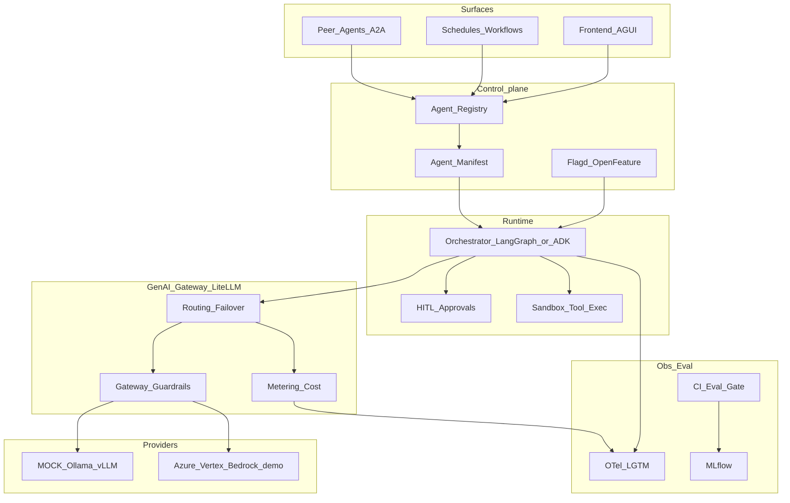
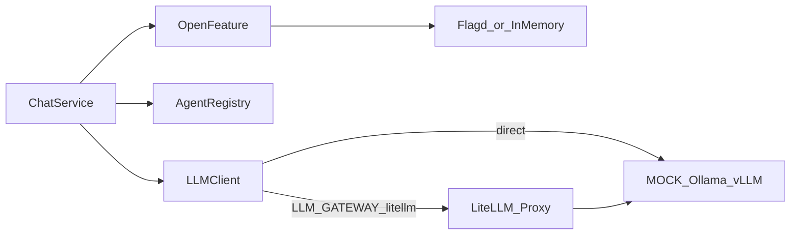

# Agent Platform Roadmap

Portfolio plan to evolve this Knowledge Platform into an **Agent Platform Engineer** showcase, plus a parallel learning path mapped to a typical agent-platform JD.

**Decisions locked**

| Decision | Choice |
| -------- | ------ |
| Deliverable | Evolve this repo in phases **and** follow a JD-mapped learning path |
| LLM perimeter | **Closed default** (MOCK / Ollama / vLLM). **LiteLLM gateway** as an optional profile. **Multi-provider demo** profile (Azure OpenAI / Vertex / Bedrock adapters or stubs) for portfolio realism — never the default |
| Demo video | **Out of scope** — no video in the repository |
| Evidence rule | Claim only what was run. Label the rest "not verified" (same as vLLM GPU today) |

This roadmap does **not** replace the course submission criteria in [`README.md`](../../README.md). Course MVP stays green; agent-platform work is additional functionality with new ADRs.

---

## Gap vs JD (summary)

| JD responsibility | Repo today | Target in this roadmap |
| ----------------- | ---------- | ---------------------- |
| Agent manifest & registry | Fixed LangGraph SM; no declarative agent spec | Single YAML/JSON manifest → registry → wire tools/memory/model/guardrails |
| GenAI gateway (LiteLLM) | Single `LLMClient` ([`llm.py`](../../app/backend/kp/infrastructure/llm.py)) | LiteLLM proxy: routing, failover, metering, cost attribution; local + multi-provider demo |
| Long-running / streaming / HITL | SSE + LangGraph checkpoints; Celery for ingest; Temporal rejected for ingest ([ADR-008](../../architecture/adr/ADR-008-sync-async-cache.md)) | HITL interrupts, resume, queue/retry for agent runs; Temporal as optional later learning track |
| Feature flags / kill-switch | Env toggles | OpenFeature + Flagd; progressive prompt/model rollout; emergency kill-switch + audit |
| Reliability / SLOs / runbooks | Capacity + load docs | Gateway failover runbook, agent SLOs, on-call sketch |
| Observability & eval | OTel LGTM + golden eval + DeepEval | Keep LGTM; add MLflow registry; optional Braintrust/Datadog LLM Obs exporters |
| Reference agents | One GraphRAG chat agent | 1–2 reference agents on the new manifest (keep GraphRAG; add a tool-using / A2A peer) |
| Protocols MCP / A2A / AG-UI | Absent | MCP tools first → A2A between agents → AG-UI event stream to UI |
| K8s CRDs / multi-cloud | Helm + AWS Terraform (unverified); no GKE/Azure | Kustomize overlays; Agent CRD sketch; GCP/Azure Terraform stubs labeled unverified |
| Regulated data narrative | ACL / audit / hardening | Compliance-oriented audit trail design (GDPR-style data handling notes; not a certification claim) |

---

## Architecture target (high level)

### Request path (Chat → flags → LiteLLM proxy)

Concrete control/data path for Phases 2–3. Closed default keeps `LLMClient` on MOCK/Ollama/vLLM; with `LLM_GATEWAY=litellm` the same client talks to the LiteLLM proxy. Details: [genai-gateway.md](./genai-gateway.md), [feature-flags.md](./feature-flags.md).

**Profile matrix**

| Profile | Gateway | Backends | When |
| ------- | ------- | -------- | ---- |
| `closed` (default) | Direct `LLMClient` or LiteLLM → local only | MOCK / Ollama / vLLM | CI, desktop, course demo |
| `gateway-local` | LiteLLM required | Same local backends | Prove routing/metering without leaving perimeter |
| `gateway-multiprovider` | LiteLLM | Local + Azure/Vertex/Bedrock (real keys or recorded stubs) | Portfolio; mark runtime verified only when exercised |

---

## Phased delivery (repo)

Each phase: ADR → minimal code → tests → docs update in README “additional functionality”. Prefer vertical slices over big-bang rewrites. Keep LangGraph GraphRAG path working; do not break the course eval gate.

### Phase 0 — Foundations (1–2 weeks)

**Goal:** Decide boundaries without shipping dead weight.

- New ADR index entries (drafts):
  - **ADR-011** Agent manifest & registry
  - **ADR-012** GenAI gateway (LiteLLM) and provider profiles
  - **ADR-013** Feature flags (OpenFeature / Flagd) and kill-switch
  - **ADR-014** Agent protocols (MCP → A2A → AG-UI)
  - **ADR-015** Long-running agent runs & HITL (amend relation to ADR-008: Celery stays for ingest; agent runs use LangGraph interrupts first)
- Amend **ADR-001**: closed default remains; gateway profiles are additive
- Amend **ADR-006**: optional SaaS exporters (Braintrust / Datadog) never required for CI
- Skeleton dirs only if needed: `app/backend/kp/agents/`, `app/infra/flagd/`, `app/infra/litellm/`
- Update [README](../../README.md) “Current state vs plan” table to point here
- **Out of scope:** Demo video

**Exit:** ADRs accepted (or Proposed with clear open questions); no behavior change required yet.

### Phase 1 — Agent manifest & registry (JD #1) — **done in code**

**Goal:** One declarative spec that can register an agent and resolve model/tools/memory/guardrails.

Shipped:

- Manifest schema + [ADR-011](../../architecture/adr/ADR-011-agent-manifest-registry.md)
- Disk manifests: [`app/backend/agents/`](../../app/backend/agents/) (`graphrag-chat`, `label-assistant`)
- Registry + HTTP: `GET/POST /v1/agents`, `GET …/resolve`, `POST …/invoke`
- `/v1/chat` authorizes `DEFAULT_AGENT_ID` / `agent_id`
- Tests: `tests/test_agent_registry.py` · how-to: [agents.md](./agents.md)

**Exit:** GraphRAG agent listed in registry; chat path still passes eval gate.

### Phase 2 — GenAI gateway on LiteLLM (JD #2) — **done in code**

**Goal:** Own a real gateway path without abandoning the air gap.

Shipped:

- [ADR-012](../../architecture/adr/ADR-012-genai-gateway.md) · [genai-gateway.md](./genai-gateway.md)
- Compose profile `gateway` + [`app/infra/litellm/`](../../app/infra/litellm/) (`gateway-local` + multiprovider stubs)
- `LLM_GATEWAY=litellm` → `LLMClient` provider `LITELLM`; closed default unchanged
- Audit/metrics attribution: `agent_id`, `team_id`, `gateway`, `model_route`
- Tests: `tests/test_llm_gateway.py` (no LiteLLM container required for CI)

Live LiteLLM+Ollama Compose runtime: **not verified** until exercised on a machine.

### Phase 3 — Feature flags & kill-switch (JD progressive rollout) — **done in code**

**Goal:** Progressive rollout for prompts, models, configs + emergency stop.

Shipped:

- [ADR-013](../../architecture/adr/ADR-013-feature-flags.md) · [feature-flags.md](./feature-flags.md)
- [`app/infra/flagd/flags.json`](../../app/infra/flagd/flags.json) + Compose profile `flags`
- In-memory evaluator (CI) / OFREP when `FLAGD_URL` set
- Kill-switch + `agent_enabled` → 503 + audit `deny_kill_switch`
- `prompt_version` / `model_route` on audit; LiteLLM alias follows `model_route` when gateway is on
- Tests: `tests/test_feature_flags.py`

### Phase 4 — Protocols: MCP → A2A → AG-UI

**Goal:** Interoperability story matching the JD.

1. **MCP:** Expose 1–2 tools (e.g. policy retrieve, audit lookup) as an MCP server; optional MCP client tool node for a second agent
2. **A2A:** Minimal agent-to-agent call between registry agents (request/response + task id); document mapping to Google A2A concepts
3. **AG-UI:** Map SSE chat events to AG-UI-style event types in BFF/frontend (or adapter layer); keep existing SSE working

**Google ADK:** Spike in a **side module** or second reference agent (Phase 6). Do not rip out LangGraph for the course agent. ADR documents “ADK or similar” coexistence.

**Exit:** One MCP tool used in a path covered by tests; A2A ping between two agents; UI still streams.

### Phase 5 — Long-running reliability & HITL (JD #3 / #5)

**Goal:** Production-shaped control plane for agent runs.

- LangGraph interrupt / approval node for sensitive actions (e.g. export or policy override)
- Run store: status, snapshot, resume API (`/v1/runs/{id}`)
- Queue + retries for async agent runs (reuse Redis/Celery **or** a dedicated run worker — ADR-015 decides; do not force Temporal into ingest)
- SSE resilience notes (heartbeat, reconnect) in BFF; WebSocket only if AG-UI needs it
- SLO draft + runbook: gateway failover, kill-switch, stuck runs
- Sandbox: tighten tool execution (timeouts, allowlisted tools, no arbitrary shell); document gVisor/Firecracker as future hardening

**Exit:** HITL approve/reject path tested; resume from checkpoint demonstrated.

### Phase 6 — Observability, eval, model registry (JD #6)

**Goal:** Online + offline loop without making SaaS mandatory.

- **MLflow:** model / prompt version registry linked to Flagd variants; local tracking server in Compose optional profile
- Keep golden-set CI gate; add optional LLM-as-judge path (already DeepEval-shaped)
- Export hooks: OTel → Datadog LLM Observability (docs + optional exporter); Braintrust dataset export from traces (script, optional)
- Trace enrichment: tool calls, flag variant, gateway route, agent id on every span
- Compliance audit: durable audit sink option (Postgres/MinIO) beyond in-memory `/v1/audit`

**Exit:** CI unchanged without SaaS; optional profiles documented; at least one “trace → eval case” script.

### Phase 7 — Platform packaging & multi-cloud sketches

**Goal:** Kubernetes-native and IaC story for the JD “nice to have”.

- Kustomize overlays: `closed`, `gateway-local`, `gateway-multiprovider`
- Agent CRD **sketch** + sample manifest (operator can be stub/controller-lite or docs-only if time-boxed)
- Terraform stubs: GCP (GKE) and Azure (AKS) mirroring `app/infra/aws/` style — **not verified** until applied
- Link SLOs/runbooks from [`docs/`](../)

**Exit:** Overlays render; cloud stubs exist with honest status labels.

### Phase 8 — Reference agents & advisory docs (JD #7)

**Goal:** Validate the platform by shipping agents yourself.

1. **Reference A:** Existing GraphRAG compliance/chat agent on the manifest (hardening pass)
2. **Reference B:** Tool-using agent (MCP tools + HITL) **or** small ADK-based agent that calls the same gateway/registry
- Short “architecture trade-offs for feature teams” doc (build vs buy, when not to use multi-agent, cost controls)

**Exit:** Two agents in registry; README additional-functionality table updated. Still **no** demo video.

---

## Learning path (parallel to shipping)

Map study to JD bullets. Prefer building in this repo over isolated tutorials.

| JD theme | Learn / practice | Prove in repo |
| -------- | ---------------- | ------------- |
| Agent design patterns | LangGraph advanced (interrupt, subgraphs); Google ADK quickstart | Phase 1 + 4–5 + reference B |
| MCP / A2A / AG-UI | Spec reading + small interop demos | Phase 4 |
| Control plane (queue, retry, checkpoint) | Compare Celery vs Temporal; implement HITL resume | Phase 5; Temporal workshop optional |
| Feature flags / kill-switch | OpenFeature + Flagd tutorials | Phase 3 |
| LLM cost & capacity | LiteLLM routing docs; provider PTU/GSU reading; capacity math | Phase 2 + update [capacity-planning.md](../quality/capacity-planning.md) |
| Reliability / on-call | Write SLO + incident runbook; practice failover drill locally | Phase 2 + 5 docs |
| Security / sandbox / audit | Extend ADR-005; tool allowlists; audit durability | Phases 3, 5, 6 |
| Memory / RAG / feedback loop | Long-term memory patterns; trace→eval dataset | Phase 6 + existing GraphRAG |
| CRDs / operators | Kubebuilder or sample CRD | Phase 7 |
| Regulated environments | GDPR/HDS/ISO/SOC2 **awareness** notes — no fake certification | Audit + data-handling section in security docs |
| Languages | Python deep; Go BFF extensions; TS AG-UI client types | BFF + frontend adapters |
| Cloud | One real apply of AWS **or** GCP when hardware/account allows; others stay stubs | Phase 7 |

**Cadence suggestion:** one phase ~2–4 weeks part-time; learning spikes in the same phase’s first week.

---

## Explicit non-goals (for now)

- Demo video (none in the repository)
- Claiming production RPM, reserved-capacity contracts, or verified multi-cloud runtimes without evidence
- Replacing LangGraph course agent with ADK
- Making Datadog / Braintrust / cloud LLMs required for CI
- Full Temporal rewrite of ingest (ADR-008 stands unless a new ADR supersedes it for **agent** workflows only)

---

## Suggested first implementation slice (after roadmap accept)

1. Land ADR-011…015 as Proposed/Accepted drafts under [`architecture/adr/`](../../architecture/adr/)
2. Point README plan table at this document
3. Implement Phase 1 manifest + registry for the existing GraphRAG agent
4. Then Phase 2 `gateway-local` LiteLLM

Order maximizes JD narrative (“own the manifest” then “own the gateway”) while reusing code that already works.
