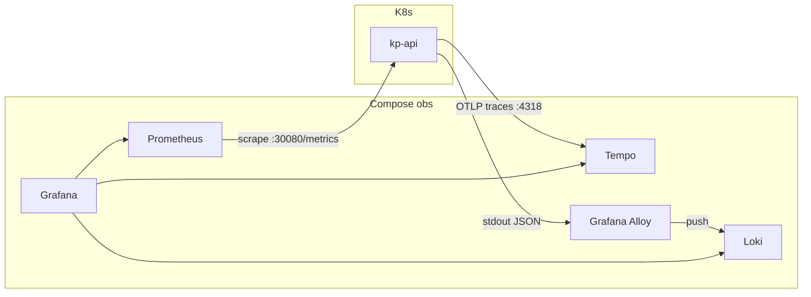

# Compose — hybrid side-stack

**Diagram:** [current-hybrid-deployment.svg](../../architecture/diagrams/images/current-hybrid-deployment.svg) (K8s + Compose side-stack)

Source: [`app/infra/docker-compose.yml`](../../app/infra/docker-compose.yml), [`Makefile`](../../Makefile).  
Startup: [SETUP.md](../SETUP.md) · ops: [SRE.md](../SRE.md) · ADR: [ADR-006](../../architecture/adr/ADR-006-observability.md).

Project: `retailpartnerx-kp`.

## The zero-overlap rule

| Layer | Where |
|------|-----|
| Platform (api, frontend, postgres, neo4j, qdrant, redis, **minio**) | **Kubernetes only** |
| LLM (**ollama**) | **Compose only** |
| Observability (prometheus, grafana, tempo, loki, alloy) | **Compose only** |

## Profiles

| Profile | Services |
|---------|---------|
| `obs` | tempo, loki, alloy, prometheus, grafana |
| `llm` | ollama |

Security scanners (separate file, ephemeral): [sec-ops.md](sec-ops.md) · `make sec-scan` · [`docker-compose.sec-ops.yml`](../../app/infra/docker-compose.sec-ops.yml).

| Target | Windows | macOS |
|--------|---------|-------|
| Hybrid up | `.\app\scripts\hybrid\hybrid-up.ps1` | `bash app/scripts/hybrid/hybrid-up.sh` |
| `llm` + `obs` | `docker compose -f app/infra/docker-compose.yml --profile llm --profile obs up -d` | same |
| Sec scanners | `.\app\scripts\sec\sec-scan.ps1` | `bash app/scripts/sec/sec-scan.sh` |

## Ports (Compose)

| Service | Port |
|--------|------|
| ollama | **11434** |
| tempo | **3200**, OTLP **4317/4318** |
| loki | **3100** |
| alloy | 12345 (UI) |
| prometheus | **9090** |
| grafana | **3000** |

Prometheus scrape (hybrid): `host.docker.internal:30080/metrics` (API NodePort).

Grafana provisioning: `app/infra/grafana/provisioning/` → datasources Prometheus + Tempo + Loki + dashboard **KP Overview** (folder Knowledge Platform).

## LGTM flow



## Hybrid flow

**Windows**

```powershell
.\app\scripts\hybrid\hybrid-up.ps1
# or: make demo
```

**macOS**

```bash
bash app/scripts/hybrid/hybrid-up.sh
# or: make demo
```

API in K8s → Ollama: `http://host.docker.internal:11434/v1`  
API → Tempo: `http://host.docker.internal:4318` (OTLP/HTTP, Helm env).  
Logs → Loki through Alloy (Docker socket + JSON stdout).

After a chat: Grafana Explore → Tempo service `kp-api`, Loki by `trace_id`, **KP Overview** panels (requests / RAG p95 / tokens).

K8s details: [k8s-architecture.md](k8s-architecture.md).
