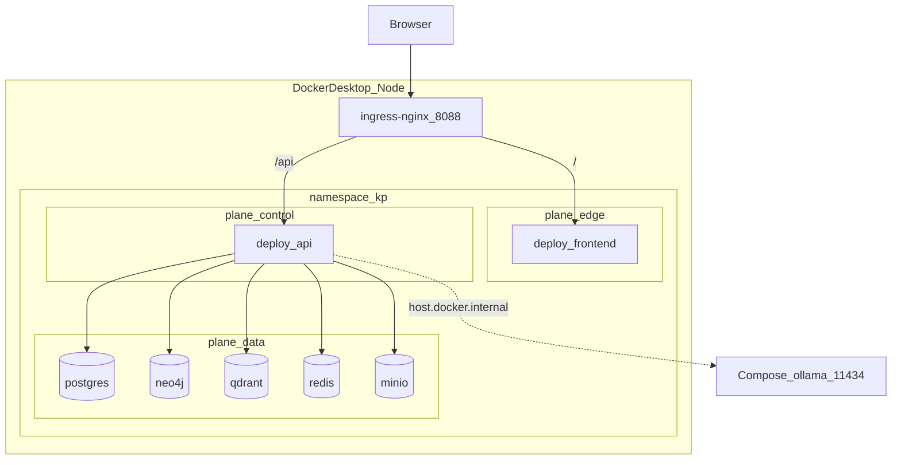

# Kubernetes Architecture (Docker Desktop + Helm)

**Diagram:** [k8s-topology-desktop.svg](../../architecture/diagrams/images/k8s-topology-desktop.svg)

Source of truth: Helm chart [`app/infra/helm/knowledge-platform/`](../../app/infra/helm/knowledge-platform/), [`app/scripts/k8s/k8s-up.ps1`](../../app/scripts/k8s/k8s-up.ps1).  
Startup: [SETUP.md](../SETUP.md) · ops: [SRE.md](../SRE.md).  
K8s / Helm objects and how to roll out features: [k8s-primer.md](k8s-primer.md).  
Logical segments: [architecture/docs/deployment.md](../../architecture/docs/deployment.md).

## Nodes

| Mode | How | Nodes |
|-------|-----|------|
| **Desktop (default)** | `kubectl` context `docker-desktop` | One Docker Desktop Kubernetes node |
| **Legacy kind** | `$env:KP_K8S='kind'` | Cluster `retailpartnerx-kp`: 1× control-plane, label `ingress-ready=true`, hostPort `8088→80` / `8443→443` ([`app/infra/kind/kind-config.yaml`](../../app/infra/kind/kind-config.yaml)) |

The chart has **no** nodeSelector / affinity / taints; all pods run on the laptop's single node.

## Namespace and labels

| Resource | Value |
|--------|----------|
| Namespace | `kp` |
| Helm release | `kp` |
| Common labels | `app.kubernetes.io/name=knowledge-platform`, `part-of=retailpartnerx-kp` |
| Plane label | `kp.retailpartnerx.io/plane` |

| Plane | Deployments |
|-------|-------------|
| `edge` | `frontend` |
| `control` | `api` |
| `data` | `postgres`, `neo4j`, `qdrant`, `redis`, `minio` |
| `mixed` | label on Namespace `kp` |

## Pods and Services (desktop default)

By default there are **7 pods**. Ollama is **not** in Helm, only in Compose (`make llm-ollama`).

| Deployment | Service | Port(s) | Replicas | Plane | Resources (requests) |
|------------|---------|---------|----------|-------|----------------------|
| `api` | `api` | 8080 | 1 | control | cpu 100m, mem 256Mi |
| `frontend` | `frontend` | 80 → 8080 | 1 | edge | cpu 50m, mem 64Mi |
| `postgres` | `postgres` | 5432 | 1 | data | — |
| `neo4j` | `neo4j` | 7474, 7687 | 1 | data | — |
| `qdrant` | `qdrant` | 6333 | 1 | data | — |
| `redis` | `redis` | 6379 | 1 | data | — |
| `minio` | `minio` | 9000, 9001 | 1 | data | — |

Other chart resources:

- Secret `kp-secrets`
- Ingress `kp-api`, `kp-ui`
- Images: `kp-api:dev`, `kp-frontend:dev` (`pullPolicy: Never` on desktop)

Desktop overlay: `STORE_BACKEND=live`, MinIO on, `LLM_PROVIDER=MOCK`.

## Ingress

| Ingress | Path | Backend |
|---------|------|---------|
| `kp-ui` | `/` | `frontend:80` |
| `kp-api` | `/api(/|$)(.*)` → rewrite `/$2` | `api:8080` |

- Host: `kp.local`
- Class: `nginx`
- Host access: ingress-nginx LoadBalancer on **:8088** / **:8443** (on Windows, `:80` is often taken by IIS)
- Annotations: body size `20m`, buffering off on the API

Hosts: `127.0.0.1 kp.local` → UI http://kp.local:8088 · health http://kp.local:8088/api/health

```
Browser → ingress-nginx :8088
          ├─ /        → svc/frontend → deploy/frontend
          └─ /api/... → svc/api      → deploy/api → data-plane Services
```

## Helm values overlays

| File | Role |
|------|------|
| [`values.yaml`](../../app/infra/helm/knowledge-platform/values.yaml) | Base: MOCK LLM, all stores on (including MinIO), replicas=1 |
| [`values-desktop.yaml`](../../app/infra/helm/knowledge-platform/values-desktop.yaml) | Desktop: `pullPolicy: Never`, live MinIO, MOCK LLM |
| [`values-desktop-compose-ollama.yaml`](../../app/infra/helm/knowledge-platform/values-desktop-compose-ollama.yaml) | Hybrid: `OLLAMA` → `http://host.docker.internal:11434/v1`, model `qwen2.5:0.5b` |

`k8s-up.ps1` + `$env:KP_LLM`:

| `KP_LLM` | Overlay |
|----------|---------|
| unset | desktop + MOCK |
| `compose-ollama` | + compose-ollama overlay |

Script: build images → install ingress-nginx (desktop) → `helm upgrade --install kp ... -n kp --create-namespace --wait`.  
Teardown: `.\app\scripts\k8s\k8s-down.ps1` (desktop keeps the shared ingress-nginx).

## What is not in Helm (Compose side-stack)

| Component | Where |
|-----------|-----|
| Prometheus / Grafana / Loki / Tempo | Compose (`obs` profile) |
| Ollama | Compose (`llm` profile) |

**Zero-overlap:** MinIO/stores/api/frontend are only in Helm. Ollama + obs are only in Compose (`make side`).

The frontend **never** calls Ollama directly, only through the API (`/v1/chat`, `/v1/llm/*`).

## Topology (Mermaid)



## Chart templates

| Template | Contents |
|----------|------------|
| `namespace.yaml` | Namespace `kp` |
| `api.yaml` / `frontend.yaml` | Control / edge Deployments + Services |
| `data-plane.yaml` | postgres, neo4j, qdrant, redis, minio |
| `ingress.yaml` | `kp-api`, `kp-ui` |
| `secret.yaml` | `kp-secrets` |
