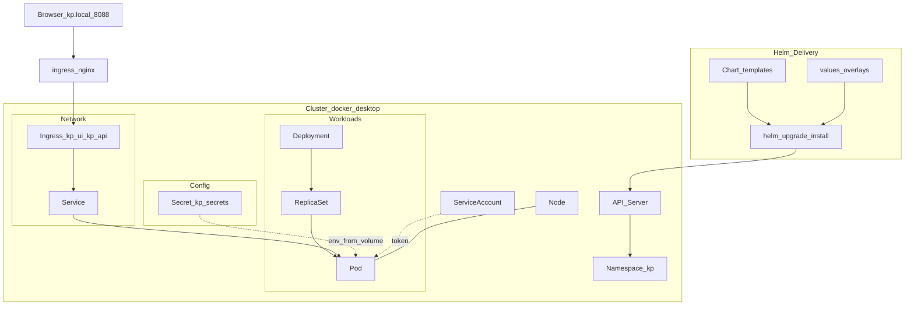
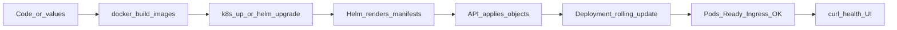

# Kubernetes + Helm Primer (objects, map, delivery)

A short learning layer over our topology. Environment in practice: [k8s-architecture.md](k8s-architecture.md) · commands: [SRE.md](../SRE.md) · startup: [SETUP.md](../SETUP.md).

In a UI (Lens / OpenLens), the left menu roughly matches the Kubernetes API groups. Below is what each object is, why it exists and what we have in the `kp` release.

---

## Helm in 30 seconds

| Term | What it is | Ours |
|--------|---------|-------|
| **Chart** | A package of YAML templates (`templates/`) + `values.yaml` | [`app/infra/helm/knowledge-platform/`](../../app/infra/helm/knowledge-platform/) |
| **Values** | Parameters (replicas, images, LLM, stores) | `values.yaml` + `values-desktop*.yaml` overlays |
| **Release** | An installed chart instance in a namespace | named `kp` in namespace `kp` |
| **helm upgrade --install** | Create or update a release atomically | `app/scripts/k8s/k8s-up.ps1` / `.sh` |

Helm is **not** a runtime: it renders manifests and hands them to the API server. Kubernetes controllers then run the Pods.

```
Chart + Values  →  helm template/upgrade  →  API Server  →  Deployments/Services/...  →  Pods on a Node
```

---

## Cluster objects (as in Lens)

### Overview / Nodes / Namespaces / Events

| Object | Why | Ours |
|----------|-------|-------|
| **Cluster / Overview** | Health summary, version, load | Docker Desktop context `docker-desktop` |
| **Node** | A machine (VM/host) that runs Pods | 1 Desktop node (or kind control-plane) |
| **Namespace** | Logical resource isolation | `kp` (+ `ingress-nginx` for the controller) |
| **Event** | A log of why a Pod is Pending / Failed | check on CrashLoop / ImagePull |

### Workloads

| Object | Why | Ours |
|----------|-------|-------|
| **Pod** | The smallest unit: 1+ containers, IP, volumes | created by controllers, rarely touched by hand |
| **Deployment** | Desired replica count + rolling image updates | `api`, `frontend`, stores (`postgres`…`minio`) |
| **ReplicaSet** | Implements replicas under a Deployment | appears automatically |
| **StatefulSet** | Stable names/disks (databases in production) | **none** (desktop: Deployment + ephemeral) |
| **DaemonSet** | One Pod per node (agents, CNI) | **none** in the chart |
| **Job / CronJob** | One-off / scheduled | **none** |

Chain: `Deployment` → `ReplicaSet` → `Pod(s)`.

### Config

| Object | Why | Ours |
|----------|-------|-------|
| **ConfigMap** | Non-secret config (files, env) | rarely used in the chart (env is in the Deployment) |
| **Secret** | Passwords, DSNs, keys (base64, which alone is not encryption) | `kp-secrets` |

### Network

| Object | Why | Ours |
|----------|-------|-------|
| **Service** | Stable in-cluster DNS/VIP → Pods by label | `api`, `frontend`, `postgres`, … |
| **Endpoints / EndpointSlice** | Actual Pod IPs behind a Service | automatic |
| **Ingress** | HTTP(S) routes from outside → Service | `kp-ui` (`/`), `kp-api` (`/api`) |
| **NetworkPolicy** | A pod↔pod firewall | default-deny with allowlists; see [k8s-hardening.md](k8s-hardening.md) |

### Storage

| Object | Why | Ours |
|----------|-------|-------|
| **PersistentVolumeClaim (PVC)** | A request for a disk | desktop: usually emptyDir / no PVC (data is not production) |
| **PersistentVolume (PV)** | The actual volume | — |
| **StorageClass** | Disk class (local, cloud SSD) | Desktop default when a PVC appears |

### Helm (in Lens)

| Object | Why | Ours |
|----------|-------|-------|
| **Release** | An installed application | `kp`, also `ingress-nginx` |
| **Chart** | Source of the templates | local path `app/infra/helm/knowledge-platform` |

### Access Control

| Object | Why | Ours |
|----------|-------|-------|
| **ServiceAccount (SA)** | A Pod's identity to the API | `default`, with the token not mounted |
| **Role / ClusterRole** | What is allowed | cluster-admin for local kubectl |
| **RoleBinding / ClusterRoleBinding** | Who holds the role | — |

### Custom Resources

| Object | Why | Ours |
|----------|-------|-------|
| **CRD + CR** | API extensions (IngressClass, Helm secrets history, …) | ingress-nginx and Helm create their own CRs/history secrets |

---

## How the objects interact

A user request and how the objects connect:



Simplified traffic path (our environment):

```
Browser → LoadBalancer :8088 (ingress-nginx)
       → Ingress (host kp.local, path / or /api)
       → Service (frontend | api)
       → Pod (Deployment)
       → (api) → Service postgres/neo4j/... → Pod store
```

---

## Delivering a feature through Helm

Goal: change code or config and safely roll it out to namespace `kp` without manually running `kubectl apply` on scattered YAML.

### Flow (desktop / hybrid)



| Step | Action | Details |
|-----|----------|--------|
| 1 | Change code / chart / values | backend, frontend, `templates/*.yaml`, overlay |
| 2 | Build images | `kp-api:dev`, `kp-frontend:dev` (`pullPolicy: Never` on Desktop) |
| 3 | Install/update the release | `.\app\scripts\k8s\k8s-up.ps1` or `helm upgrade --install kp ...` |
| 4 | Helm applies the diff | new/changed Deployment, Service, Ingress, Secret |
| 5 | The Deployment controller rolls out Pods | rolling update through ReplicaSet; old Pod → new |
| 6 | Verify | `kubectl -n kp get pods`, `curl http://kp.local:8088/api/health` |

Typical commands (Windows; for macOS see [SRE.md](../SRE.md)):

```powershell
# full cycle (images + ingress-nginx + helm)
.\app\scripts\k8s\k8s-up.ps1

# redeploy the chart only (images already built)
helm upgrade --install kp app/infra/helm/knowledge-platform -n kp --create-namespace `
  -f app/infra/helm/knowledge-platform/values-desktop.yaml `
  --wait --timeout 5m

# after changing only the LLM overlay
$env:KP_LLM = "compose-ollama"
.\app\scripts\k8s\k8s-up.ps1
# or targeted:
kubectl -n kp rollout restart deploy/api
```

### What to change for each feature type

| Change type | Where | How to roll out |
|---------------|------|--------------|
| API / UI code | `app/backend/`, `app/frontend/` | rebuild images → `k8s-up` or `helm upgrade` + restart deploy |
| Env / LLM / stores | `values*.yaml` | `helm upgrade` (then restart `deploy/api` if the env is already in the Pod) |
| New ports / Ingress path | `templates/ingress.yaml`, Service | `helm upgrade` |
| Secrets | `templates/secret.yaml` / values | `helm upgrade` (never commit production secrets) |
| LLM runtime config only | API `PUT /v1/llm/config` | no Helm; for a permanent change, use values |

### Release lifecycle

```
helm upgrade --install  →  revision N in the Helm history
helm rollback kp N-1    →  roll back manifests (images must still exist locally)
helm uninstall kp       →  delete release resources (our wrapper: k8s-down)
```

Tear down the environment: `.\app\scripts\k8s\k8s-down.ps1` (ingress-nginx on Desktop is usually kept as shared).

### Relationship with Compose (hybrid)

Helm delivers **only** in-cluster components: api, frontend, data stores, MinIO.  
Ollama and observability run in Compose (`make side` / `make llm-ollama`). See [compose-dev.md](compose-dev.md) and zero-overlap in [README.md](README.md).

---

## Lens map → our environment

| Lens menu item | What to see in `kp` |
|-----------------|-----------------|
| Nodes | one `docker-desktop` node |
| Workloads → Deployments | `api`, `frontend`, `postgres`, `neo4j`, `qdrant`, `redis`, `minio` |
| Workloads → Pods | 7 Running (desktop default) |
| Config → Secrets | `kp-secrets` |
| Network → Services / Ingress | Services + `kp-ui`, `kp-api` |
| Namespaces | `kp` |
| Helm → Releases | `kp` (chart knowledge-platform) |
| Access Control | SA `default` (lab) |
| Storage | usually empty / not critical for the demo |

Detailed ports, planes and overlays: [k8s-architecture.md](k8s-architecture.md).
