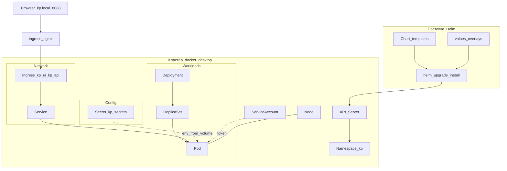
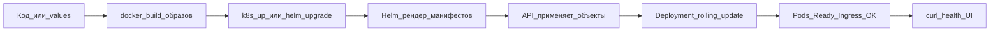

# Kubernetes + Helm — primer (сущности, схема, поставка)

Краткий учебный слой над нашей топологией. Практика стенда: [k8s-architecture.md](k8s-architecture.md) · команды: [SRE.md](../SRE.md) · запуск: [SETUP.md](../SETUP.md).

В UI (Lens / OpenLens) меню слева ≈ группы API Kubernetes. Ниже — что это, зачем, и что у нас в release `kp`.

---

## Helm за 30 секунд

| Термин | Что это | У нас |
|--------|---------|-------|
| **Chart** | Пакет шаблонов YAML (`templates/`) + `values.yaml` | [`infra/helm/knowledge-platform/`](../../infra/helm/knowledge-platform/) |
| **Values** | Параметры (replicas, images, LLM, stores) | `values.yaml` + overlays `values-desktop*.yaml` |
| **Release** | Установленный экземпляр chart в namespace | имя `kp` в namespace `kp` |
| **helm upgrade --install** | Создать или обновить release атомарно | `scripts/k8s/k8s-up.ps1` / `.sh` |

Helm **не** runtime: он рендерит манифесты и отдаёт их API-серверу. Дальше контроллеры Kubernetes сами гоняют Pod'ы.

```
Chart + Values  →  helm template/upgrade  →  API Server  →  Deployments/Services/...  →  Pods на Node
```

---

## Сущности кластера (как в Lens)

### Overview / Nodes / Namespaces / Events

| Сущность | Зачем | У нас |
|----------|-------|-------|
| **Cluster / Overview** | Сводка здоровья, версия, нагрузка | Docker Desktop context `docker-desktop` |
| **Node** | Машина (VM/хост), на которой крутятся Pod'ы | 1 нода Desktop (или kind control-plane) |
| **Namespace** | Логическая изоляция ресурсов | `kp` (+ `ingress-nginx` для контроллера) |
| **Event** | Журнал «почему Pod Pending / Failed» | смотреть при CrashLoop / ImagePull |

### Workloads

| Сущность | Зачем | У нас |
|----------|-------|-------|
| **Pod** | Минимальная единица: 1+ контейнеров, IP, volumes | создаются контроллером, руками почти не трогаем |
| **Deployment** | Желаемое число реплик + rolling update образа | `api`, `frontend`, stores (`postgres`…`minio`) |
| **ReplicaSet** | Реализация реплик под Deployment | появляется автоматически |
| **StatefulSet** | Стабильные имена/диски (БД в prod) | **нет** (desktop: Deployment + ephemeral) |
| **DaemonSet** | По Pod на каждую ноду (агенты, CNI) | **нет** в chart |
| **Job / CronJob** | Разовый / по расписанию | **нет** |

Связка: `Deployment` → `ReplicaSet` → `Pod(s)`.

### Config

| Сущность | Зачем | У нас |
|----------|-------|-------|
| **ConfigMap** | Несекретный конфиг (файлы, env) | в chart почти не используем (env в Deployment) |
| **Secret** | Пароли, DSN, ключи (base64, не шифрование само по себе) | `kp-secrets` |

### Network

| Сущность | Зачем | У нас |
|----------|-------|-------|
| **Service** | Стабильный DNS/VIP внутри кластера → Pod'ы по label | `api`, `frontend`, `postgres`, … |
| **Endpoints / EndpointSlice** | Фактические IP Pod'ов за Service | авто |
| **Ingress** | HTTP(S) маршруты снаружи → Service | `kp-ui` (`/`), `kp-api` (`/api`) |
| **NetworkPolicy** | Firewall pod↔pod | **пока нет** (см. [sec-ops.md](sec-ops.md)) |

### Storage

| Сущность | Зачем | У нас |
|----------|-------|-------|
| **PersistentVolumeClaim (PVC)** | Заявка на диск | desktop: обычно emptyDir / без PVC (данные не для prod) |
| **PersistentVolume (PV)** | Реальный том | — |
| **StorageClass** | Класс диска (local, cloud SSD) | default Desktop при появлении PVC |

### Helm (в Lens)

| Сущность | Зачем | У нас |
|----------|-------|-------|
| **Release** | Установленное приложение | `kp`, также `ingress-nginx` |
| **Chart** | Источник шаблонов | local path `infra/helm/knowledge-platform` |

### Access Control

| Сущность | Зачем | У нас |
|----------|-------|-------|
| **ServiceAccount (SA)** | Идентичность Pod'а к API | чаще `default` (lab; hardening — отдельный SA) |
| **Role / ClusterRole** | Что можно делать | cluster-admin у локального kubectl |
| **RoleBinding / ClusterRoleBinding** | Кому выдана роль | — |

### Custom Resources

| Сущность | Зачем | У нас |
|----------|-------|-------|
| **CRD + CR** | Расширения API (IngressClass, Helm secrets history, …) | ingress-nginx и Helm создают свои CR/секреты истории |

---

## Схема взаимодействия сущностей

Запрос пользователя и то, как объекты связаны:



Упрощённый путь трафика (наш стенд):

```
Browser → LoadBalancer :8088 (ingress-nginx)
       → Ingress (host kp.local, path / или /api)
       → Service (frontend | api)
       → Pod (Deployment)
       → (api) → Service postgres/neo4j/... → Pod store
```

---

## Процесс поставки фичи через Helm

Цель: изменить код или конфиг и безопасно выкатить в namespace `kp` без ручного `kubectl apply` разрозненных YAML.

### Поток (desktop / hybrid)



| Шаг | Действие | Детали |
|-----|----------|--------|
| 1 | Меняешь код / chart / values | backend, frontend, `templates/*.yaml`, overlay |
| 2 | Собираешь образы | `kp-api:dev`, `kp-frontend:dev` (`pullPolicy: Never` на Desktop) |
| 3 | Ставишь/обновляешь release | `.\scripts\k8s\k8s-up.ps1` или `helm upgrade --install kp ...` |
| 4 | Helm применяет diff | новые/изменённые Deployment, Service, Ingress, Secret |
| 5 | Deployment-контроллер катит Pod'ы | rolling update через ReplicaSet; старый Pod → новый |
| 6 | Проверка | `kubectl -n kp get pods`, `curl http://kp.local:8088/api/health` |

Типовые команды (Windows; macOS — [SRE.md](../SRE.md)):

```powershell
# полный цикл (образы + ingress-nginx + helm)
.\scripts\k8s\k8s-up.ps1

# только перевыкат chart (образы уже собраны)
helm upgrade --install kp infra/helm/knowledge-platform -n kp --create-namespace `
  -f infra/helm/knowledge-platform/values-desktop.yaml `
  --wait --timeout 5m

# после смены только LLM overlay
$env:KP_LLM = "compose-ollama"
.\scripts\k8s\k8s-up.ps1
# или точечно:
kubectl -n kp rollout restart deploy/api
```

### Что менять под тип фичи

| Тип изменения | Куда | Как выкатить |
|---------------|------|--------------|
| Код API / UI | `backend/`, `frontend/` | rebuild images → `k8s-up` или `helm upgrade` + restart deploy |
| Env / LLM / stores | `values*.yaml` | `helm upgrade` (потом restart `deploy/api`, если env уже в Pod) |
| Новые порты / Ingress path | `templates/ingress.yaml`, Service | `helm upgrade` |
| Секреты | `templates/secret.yaml` / values | `helm upgrade` (не коммитить прод-секреты) |
| Только конфиг в рантайме LLM | API `PUT /v1/llm/config` | без Helm; для постоянного — values |

### Жизненный цикл release

```
helm upgrade --install  →  revision N в истории Helm
helm rollback kp N-1    →  откат манифестов (образы должны ещё быть локально)
helm uninstall kp       →  удалить ресурсы release (у нас обёртка: k8s-down)
```

Снос стенда: `.\scripts\k8s\k8s-down.ps1` (ingress-nginx на Desktop обычно оставляют shared).

### Связь с Compose (hybrid)

Helm поставляет **только** in-cluster: api, frontend, data stores, MinIO.  
Ollama и observability — Compose (`make side` / `make llm-ollama`). См. [compose-dev.md](compose-dev.md) и zero-overlap в [README.md](README.md).

---

## Карта Lens → наш стенд

| Пункт меню Lens | Смотреть в `kp` |
|-----------------|-----------------|
| Nodes | одна нода `docker-desktop` |
| Workloads → Deployments | `api`, `frontend`, `postgres`, `neo4j`, `qdrant`, `redis`, `minio` |
| Workloads → Pods | 7 Running (desktop default) |
| Config → Secrets | `kp-secrets` |
| Network → Services / Ingress | Services + `kp-ui`, `kp-api` |
| Namespaces | `kp` |
| Helm → Releases | `kp` (chart knowledge-platform) |
| Access Control | SA `default` (lab) |
| Storage | обычно пусто / не критично для демо |

Детальные порты, planes и overlays: [k8s-architecture.md](k8s-architecture.md).
